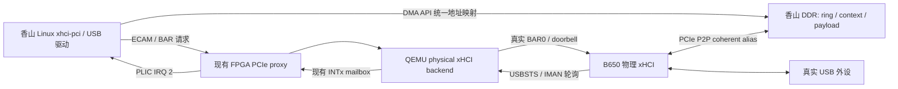

# B650 USB 与香山物理 xHCI 接管

更新时间：2026-10-11。实现分支：`usb-b650-xhci`。

## 目标及结论

香山可以像本地 NVMe 路径一样接管主机侧的物理 xHCI。此次实现保留物理控制器的
vendor/device/class 身份，转发其真实 BAR0，USB 枚举、端点配置和数据传输由香山
Linux 的标准 `xhci-pci`/USB 驱动执行。主机必须先解绑选定的 USB PCI function。
没有使用 QEMU `usb-host`、USB/IP 或软件 xHCI 来执行 USB 请求。

仍由现有 FPGA/QEMU 代理提供香山可见的 PCIe switch、配置空间和 BAR 路由；
这不要求复制主机 B650 switch 的完整拓扑。B650 的 SATA、M.2 和桥设备仍可留给
主机，解绑对象是 `class=0x0c0330` 的 xHCI function。该 function 管理的所有 USB
端口一起交给香山，不能继续在主机上同时使用它们。xHCI 的 HCRST 只用于 USB
控制器；本方案不重置或解绑 B650 switch。

本机当前只有 Intel `8086:a1af` 板载 xHCI，尚未枚举到 B650 扩展卡。已完成软件
构建和模拟 I/O 测试；物理 P2P DMA、USB 枚举及性能尚未验证。

只读检查的 FPGA 资源中，`0000:d8:00.0` 的 BAR4 为 16 GiB，覆盖默认 coherent
alias/DDR 窗口，实际 IOMMU group type 为 identity。`0000:86:00.0` 的最后一个
memory BAR 只有 4 MiB，不能使用当前默认窗口。启动时须核对 XDMA 节点所属 BDF，
不能仅按 `/dev/xdma0_*` 名称选择；上述 BAR/IOMMU 检查并不证明设备 P2P 路由。
当前执行环境的 `/dev` 下没有 XDMA 节点，还需确认驱动及设备节点可用。

## B650 卡的具体特性与资料

[设计者的 AMD B650 南桥扩展卡资料](https://oshwhub.com/wesd/b650)说明：PCIe 4.0 ×4
上行，可扩展两个 PCIe 4.0 ×4 M.2、四个 SATA 6 Gb/s 和一个 USB 3.2 Gen2×2
接口，卡必须烧录固件才能正常使用。作者报告 Intel 平台可识别。实际卡的固件、
焊接版本和接口连接必须核对，不能从“B650”名称推断所有接口都已引出。

[AMD AM5 官方规格](https://www.amd.com/en/products/processors/chipsets/am5.html)给出
芯片组提供的 USB/SATA 上限；这些不能与 CPU 直连的 PCIe 5.0 通道混为一谈。
[AMD Promontory 21 内核补丁](https://lists.openwall.net/linux-kernel/2026/05/12/2633)
描述该芯片的 xHCI PCI glue，并提及 B650/PROM21 扩展卡。
PCI ID 可能受固件影响；程序检查 PCI class 和控制器能力，不硬编码 `1022:43f7`。

USB Gen2×2 链路能力由真实控制器和连接设备协商。软件没有用虚拟 USB 3.0
控制器降低链路能力，但代理 MMIO/INTx 延迟可能限制实际吞吐和实时性。

## 为什么 NVMe 的地址重写不能直接用于 xHCI

本地 NVMe 后端已经转换 ASQ/ACQ、SQ/CQ 及 PRP 地址。xHCI 的 DMA 地址还出现在
DCBAA、slot/endpoint context、command/transfer/link TRB、scratchpad、stream
context、ERST/event ring 和 USB payload 中；event 中的 TRB pointer 又需要被
驱动识别。仅转换 CRCR/DCBAAP/ERSTBA，或仅转发 BAR，会遗漏嵌套指针。

此次方案在 PCI firmware/DMA 配置层对单个 xHCI function 安装 `dma_range_map`。
标准 Linux DMA API 为所有 coherent allocation 和 streaming mapping 生成同一
地址域内的 handle，`dma_to_phys()` 仍可逆向释放内存。USB 请求的 DMA 设备是
该 PCI controller，因此 ring、context 和 payload 都使用同一套规则。
NVMe、IGB、IXGBE 和 Vortex 的 DMA 配置保持原样。

```text
guest CPU physical = G
physical xHCI DMA bus address = FPGA host BAR base + coherent alias base + G
```

例如 `BAR base=0x800000000`、`alias=0x100000000`、guest DDR 起点
`0x80000000` 时，guest buffer `0x82000000` 的 xHCI DMA handle 是
`0x982000000`。FPGA 将 coherent alias 的偏移转换回香山 DDR。



## 软件改动和协议

QEMU 增加 `type: "xhci"` 本地物理后端及 `allow-unsafe-xhci-p2p` 属性。
当前不支持 `remote-rdma` xHCI。BAR0 上限继承管理器的 1 MiB aperture；要求
物理 HCCPARAMS1.AC64=1。初始化检查未绑定任何驱动、host MSI/MSI-X 已关闭、
host IOMMU 为 identity/no-IOMMU、控制器可以停止且没有 BIOS owner。

保留物理 PCI SBRN（USB Serial Bus Release Number，offset `0x60`），供原生
`xhci-pci` setup 读取。64-bit 指针支持 Linux `xhci_write_64()` 的低/高两个
32-bit MMIO 访问，原样转发两次写入；不依赖 guest 发出单次 64-bit store。

PCI capability 链为 PCIe → vendor capability。MSI/MSI-X/PM capability 没有向
香山暴露；当前使用 legacy INTx，物理 PCI command 始终设置 INTX_DISABLE。
HCSPARAMS1 的 MaxIntrs 限为一，其他物理能力和 USB 端口照常读回。
中断桥检查 USBCMD.INTE、USBSTS.EINT 和 interrupter 0 的 IMAN.IP/IE，并尊重
guest PCI INTX_DISABLE。驱动对真实 IMAN/USBSTS 的 W1C 写回解除中断状态。

vendor capability 位于 `0xb0`，40 字节：

| 相对偏移 | 数据 | 属性 |
| --- | --- | --- |
| 0 / 1 | PCI_CAP_ID_VNDR / next=0 | 只读 |
| 2 / 3 | length=40 / version=1 | 只读 |
| 4 | signature=`0x53435045` | 只读 |
| 8 | flags=3：translated DMA + coherent | 只读 |
| 12 | READY=`0x444d4150`，撤销为 0 | guest 可写 |
| 16 | guest CPU DDR base，64 bit | 只读 |
| 24 | 对应 host PCI DMA bus base，64 bit | 只读 |
| 32 | DDR size，64 bit | 只读 |

Linux `pci_dma_configure()` 在原 OF/ACPI DMA 配置之后读取上述描述。只匹配 SCOPE
签名及 xHCI class，要求 direct DMA ops，窗口完整覆盖 guest RAM。它安装
per-device map 后写 READY 并读回；driver remove/失败时撤销 READY 并恢复原映射。
没有该功能的内核不能使物理控制器 DMA：QEMU 在 READY 与 guest BME 同时满足前
保持物理 BME 关闭并拒绝 RUN/队列/doorbell 写，只允许停止和复位 USBCMD。

doorbell 复用已有 `BAR_WRITE_DONE`：先回应 guest MMIO、请求 DONE，接到匹配的
sequence/offset 后才写物理 doorbell。无需修改 32 字节 DMA32 协议或 RTL。
1 秒内没有 DONE 则进入失败并关闭物理 BME。其他 BAR 写以物理 USBSTS readback
排空 posted write。退出时先停止 xHC、关闭 BME，再恢复原 PCI command 的其他位，
不会把含 guest queue 地址的控制器重新置为 host bus master。

## P2P 和 IOMMU 是真实前提

[Linux P2PDMA 文档](https://docs.kernel.org/driver-api/pci/p2pdma.html)指出：同一 PCIe
hierarchy 中的路由受 ACS 控制，跨 root port/host bridge 的转发不由 PCIe 规范
保证。B650 插在主机上，不代表它一定能 DMA 到另一插槽的 FPGA BAR。

优先选择能够在共同 PCIe switch 下路由的拓扑。不同 root port 必须验证 host
平台支持 P2P；不能以 CPU mmap/read/write BAR 成功代替设备 DMA 测试。
主机必须让控制器发出的地址直达 PCI bus aperture。普通 VFIO translated domain
和 `iommu=pt` 的名称本身均不能作为证明；本实现检查 target group 的实际 type，
读取不到或不是 identity 时拒绝启动。需要内存安全隔离的 VFIO/IOMMU 映射方案
不在本次 raw P2P 实现内。`allow-unsafe-xhci-p2p=on` 明确选择与现有 raw 本地设备
路径相同的信任模型。

## 操作步骤

先只读识别卡和 USB 端口：

```sh
python3 tools/scope_usb_preflight.py
lspci -Dnn -t
lsusb -t
```

选择真实 xHCI BDF 和 FPGA BDF；下面用环境变量，示例 JSON 中的 BDF 不代表本机。
先确认该 xHCI 下没有主机需要的键盘、系统 USB 盘或其他使用中的设备，停止相关
使用再只解绑这个 function。不要解绑 B650 switch。

```sh
export XHCI_BDF=<卡上的USB-controller-BDF>
export FPGA_BDF=<实际FPGA-BDF>
cat /sys/bus/pci/devices/$XHCI_BDF/class
# 必须为 0x0c0330；在确认端口归属后执行：
printf '%s' "$XHCI_BDF" | sudo tee /sys/bus/pci/devices/$XHCI_BDF/driver/unbind
sudo python3 tools/scope_usb_preflight.py \
  --xhci-bdf "$XHCI_BDF" --fpga-bdf "$FPGA_BDF" \
  --config-out vswitch-backends-usb-xhci.json
```

若 preflight 报不同 root port/ACS redirect，先验证设备 P2P 路由；验证后才能在
preflight 中加 `--allow-cross-root`。工具不会更改驱动、IOMMU 或 ACS。

构建香山内核。这里的 USB/HID/存储选项均内建，PCI DMA helper 是必需项：

```sh
export SCOPE_INITRAMFS="$(pwd)/nanhu-g/software/rootfs/initramfs.txt"
cd work_farm/software/linux
make O=/tmp/nexst-usb-linux-build ARCH=riscv CROSS_COMPILE=riscv64-linux-gnu- riscv_serve_defconfig
make O=/tmp/nexst-usb-linux-build ARCH=riscv CROSS_COMPILE=riscv64-linux-gnu- CONFIG_INITRAMFS_SOURCE="$SCOPE_INITRAMFS" -j16 Image
```

先确认 initramfs manifest 的所有 `file` 源路径都存在，并指向当前工程的 rootfs；
复制 checkout 可能仍带旧绝对路径，应按既有 rootfs 流程重新生成或在临时副本中
修正路径。本次使用已检查的 `/tmp/nexst-usb-firmware/initramfs.txt` 临时副本。
仅按 defconfig 构建会没有 initramfs；当前 DTS 也没有外部 root 参数。

当前启用 USB bulk-only storage（BOT）和 UAS。仓库旧 UAS workaround 针对 Xilinx
DWC3 stream timeout，使用已移除的 `scsi_cmnd.scsi_done` 字段，还手工创建脱离
SCSI request 生命周期的命令。B650 PCI xHCI 不启用对应 `XHCI_STREAM_QUIRK`。
本分支将 `drivers/usb/storage/uas.c` 恢复为本树 v5.16 合入父版本
`21e04e47b5f7` 的上游实现，使用标准 SCSI 完成与错误处理；原 DWC3 专用
dummy-INQUIRY 恢复流程不再保留。UAS 已通过完整编译，stream/数据传输待上板验证。

按现有 ICT/香山平台参数将新 Image 打包到 OpenSBI payload，不能继续加载旧内核。
以下命令从上述 Linux 目录返回工程根目录，仅在 `/tmp` 生成产物：

```sh
cd ../../..
mkdir -p /tmp/nexst-usb-firmware
dtc -I dts -O dtb -o /tmp/nexst-usb-firmware/XSTop_vpcie.dtb nanhu-g/software/dt/XSTop_vpcie.dts
make -C nanhu-g/software/opensbi O=/tmp/nexst-usb-firmware/opensbi \
  CROSS_COMPILE=riscv64-linux-gnu- PLATFORM=ict \
  PLATFORM_RISCV_ISA=rv64imafdc_zicsr_zifencei \
  OPENSBI_PAYLOAD=/tmp/nexst-usb-linux-build/arch/riscv/boot/Image \
  FW_FDT_PATH=/tmp/nexst-usb-firmware/XSTop_vpcie.dtb \
  SERVE_PLAT=h HART_COUNT=1 RV_TARGET=xiangshan WITH_SM=n -j16
```

产物为 `/tmp/nexst-usb-firmware/opensbi/platform/ict/firmware/fw_payload.bin`。
现有 `XSTop_vpcie.dts` 的 PCI ranges/INTx 映射够用，无需添加全局 dma-ranges。
具体固件及 bootrom 装载继续使用工程现有工具；本次没有改写或加载硬件。

主机还需要现有的 SCOPE XDMA 驱动（包括 DMA32 doorbell ioctl）。针对当前主机
`5.15.135-yfl`，已在临时目录构建
`/tmp/nexst-usb-host-driver/xdma/xdma.ko`，vermagic 与运行内核匹配，尚未加载。
若换主机，须使用该主机的内核构建目录重新编译并检查 vermagic：

```sh
make -C shell/software/xdma_drv/XDMA/linux-kernel/xdma -j8
modinfo -F vermagic shell/software/xdma_drv/XDMA/linux-kernel/xdma/xdma.ko
```

UART 回调按 Linux API 版本选择签名，兼容当前主机：console putchar 在
[5.17](https://raw.githubusercontent.com/torvalds/linux/v5.17/include/linux/serial_core.h)
与 [5.18](https://raw.githubusercontent.com/torvalds/linux/v5.18/include/linux/serial_core.h)
间由 int 改为 unsigned char；set_termios old 参数在
[6.0](https://raw.githubusercontent.com/torvalds/linux/v6.0/include/linux/serial_core.h)
与 [6.1](https://raw.githubusercontent.com/torvalds/linux/v6.1/include/linux/serial_core.h)
间增加 const。此次修正不改变 UART 寄存器或 DMA 协议。

构建并启动 QEMU，XDMA 设备节点按实际 FPGA 实例设置：

```sh
cd qemu-mount
ninja -C build-rdma-repo17-review qemu-system-x86_64
cd ..
sudo qemu-mount/build-rdma-repo17-review/qemu-system-x86_64 \
  -machine q35 -m 128M -display none -monitor none -serial none \
  -device pcie-root-port,id=rp1,bus=pcie.0 \
  -device scope-fpga-vswitch,bus=rp1,backend-config=vswitch-backends-usb-xhci.json,fpga-host-bdf="$FPGA_BDF",xdma-user-dev=/dev/xdma0_user,xdma-ctrl-dev=/dev/xdma0_control,xdma-bypass-dev=/dev/xdma0_bypass,guest-ddr-base=0x80000000,guest-ddr-size=0x80000000,allow-unsafe-xhci-p2p=on
```

QEMU 初始化完成后再解除香山 reset。香山侧应看到：

```text
SCOPE coherent P2P DMA: CPU ... -> bus ..., size ...
xhci_hcd ...: new USB bus registered
usb ...: New USB device found, idVendor=..., idProduct=...
```

用 guest `lspci -nnk`、`dmesg`、`/sys/bus/usb/devices` 检查；有 usbutils 时可用
`lsusb -t`。先验证插拔和 HID，再用独立 USB 测试盘做读及写后校验。最后停止
香山/代理，确认物理 xHC 已 halted/BME 已关闭，再让主机重新 probe：

```sh
printf '%s' "$XHCI_BDF" | sudo tee /sys/bus/pci/drivers_probe
```

## 验证与当前边界

软件测试 `bash qemu-mount/tests/scope-usb/run.sh` 使用 LD_PRELOAD 将指定的测试
BDF/sysfs 和 XDMA ioctl 指向临时普通文件，运行生产 QEMU 后端。它覆盖物理身份、
capability/DMA 窗口、READY/BME/RUN 门控、64-bit BAR 与低/高 dword 转发、doorbell DONE 顺序和
INTx mask/clear、legacy OS ownership/SMI 交接、DONE 超时后的 BME 关闭，并检查
拒绝 bound/translated-IOMMU/非xHCI/MSI/32-bit-DMA/无显式选择，以及错误 BAR
布局、CNR、BIOS ownership。BIOS/CNR 拒绝路径还检查没有写入物理 USBCMD。
普通文件没有真实 W1C 或 DMA，只能证明软件控制路径。

2026-10-11 已通过生产 QEMU 构建及上述 11 组 I/O fixture；同一脚本编译实际
guest DMA helper，使用 ASan/UBSan 验证映射、逆向映射、解绑/重新绑定、8 种
错误 capability 描述和关闭 Kconfig 时的拒绝。完整 RISC-V Linux `Image`
已在 `/tmp/nexst-usb-linux-build/arch/riscv/boot/Image` 生成；带现有 initramfs 的
最终 UAS-enabled Image 为 49,124,352 字节；ICT OpenSBI payload 为
51,221,512 字节，已核对内核/DTB 嵌入内容。SHA256 为
`fd1217d59fc2ceb085d262e6d2d9f455d9cc96b156fbc08ba26d68c17b2faf8c`。
现有 NVMe PRP/CQ、remote completion 和 GIDS 回归分别通过 2,581、12、7 项。
preflight 的临时 sysfs fixture 也检查了 bound/IOMMU/ACS/窗口溢出等 9 个场景。

必须上板补齐：真实 coherent P2P 读写、command/event ring、USB2/USB3 枚举、插拔、
HID、bulk 数据校验、多设备压力、错误/超时后恢复。ISO 音视频、stream、
suspend/resume 和 Gen2×2 吞吐均未验证；它们由标准驱动及真实 xHC 执行，但不能
因此声明本桥接路径已经通过这些项目。

## 修改前的远端基线

2026-10-11 在改 USB 代码之前已推送：NexST `nm37_vswitch/f6ea682`、work_farm
`nm37_vswitch/5d33b1e`、Linux `nm37_vswitch/60f53740f759`。QEMU 的
`nm37_vswitch/6a30be8` 已在 origin。修正主机驱动前也确认推送 XDMA 的
`nm37_proxy/e63f5a1`（origin 已存在该提交），再创建 USB 分支。
USB 工作分别位于上述五个仓库的 `usb-b650-xhci` 新分支。原有构建目录、
展开的符号链接和 autotools 产物未提交。
