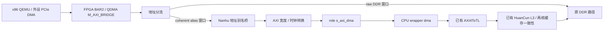

> 历史记录：当前普通单/双核 bridge 实现见 [KUNMINGHU_SCOPE_BRIDGE_IMPLEMENTATION.md](KUNMINGHU_SCOPE_BRIDGE_IMPLEMENTATION.md)。下文不是当前构建状态。

# VP1902 双核普通昆明湖：补齐 guest coherent DMA 的分析

本轮仅分析硬件和软件修改范围。XS-AI 构建已停止，41 上的双核普通昆明湖
PID `2114919` 继续构建现有基线；本轮没有修改正在综合的 RTL。

## 结论与代码依据

普通昆明湖已经提供进入 L3 的 AXI slave DMA 通路，初步判断可以复用 Nanhu 的
BAR 别名桥，补齐外围接线，不需要先新增 XSAI/CHI DMA requester，也不需要
重新实现双 BAR vSwitch 或 QDMA 主机 completion ring。
这一判断依据真实锁定源码和实际生成接口，仍需要缓存一致性仿真及板上验证。

CPU 为 `OpenXiangShan/XiangShan` 提交
`4bbdccbb077840af5e1b65c7138d31af3966f625`，`FpgaDefaultConfig`、2 核、
`enableCHI=false`。已核对：

- `src/main/scala/system/SoC.scala:239` 的 `HaveSlaveAXI4Port`，DMA 输入经过
  `AXI4IdIndexer`、`AXI4Fragmenter`、`AXI4ToTL` 进入 `l3_xbar`。
- 同文件 `l3_xbar` 经 `l3_banked_xbar` 接入 L3；
  `src/main/scala/top/Top.scala:194` 将 HuanCun L3 插入该路径。
- `Top.scala:243` 导出 AXI slave DMA，实际生成的 `XSTop.v` 有完整 `dma_*` 端口。
- `SoC.scala` 将低于 `0x80000000` 的 DMA 地址送往 error device。
  现有 guest DDR 窗口从 `0x80000000` 开始，与该约束相符。

当前缺口有三层：`prepare_xstop_wrapper.py` 停用了 CPU 的 `dma_*`；
`role_top_proto.v` 的 `s_axi_dma` 返回固定无请求状态，没有连进 role BD；
shell 的 QDMA `M_AXI_BRIDGE` 只通向 DDR，缺少进入 role DMA 的地址分流。

## 可复用的 Nanhu 模块

已有模块：

```text
nexst_nanhu_g_host_peripherals/
  shell/nm37_vu37p/fpga/sources/hdl/recorder/axi_alias_attr_bridge.v
```

远端 `Nullray/nexst:feature/nanhu-g-host-nic-usb` 提交
`4f2d7660b9c853766ba08a3956dccc0789480dc9` 的同名文件与本地逐字节一致，SHA256：

```text
5db249909bb693713c650d456d44d5e4a1bfe61281e4e72a97dd9d6ba03a8aa3
```

模块保留 AXI 五个通道、WSTRB、ID 与背压，减去可配置的地址偏移，并设置
`AxCACHE`。NM37 已有完整的 bypass 地址分流、别名桥及 role DMA 接法可参照。
桥中的 `AxCACHE=0xf` 本身不实现 CPU cache snoop；一致性要由后面的
AXI4ToTL/L3 路径提供，不能仅添加该属性或修改能力位就视为完成。

## 建议数据通路



QDMA completion ring 保持原控制通知用途。外设描述符、网络包和 USB 数据
通过上述 guest 内存路径访问，两者并行存在。

## 实际接口参数与适配

以下 QDMA 参数来自 41 上生成的 `xiangshan_qdma_ep_0.xci`，CPU 参数来自
实际双核 `XSTop.v`，role 参数来自当前 BD 与 wrapper：

| 接口 | 地址位宽 | 数据位宽 | ID 位宽 | 时钟 |
| --- | ---: | ---: | ---: | ---: |
| QDMA M_AXI_BRIDGE | 64 | 512 | 4 | 250 MHz |
| 当前 role s_axi_dma | 36 | 256 | 12 | 50 MHz |
| 双核 XSTop dma | 48 | 256 | 14 | 50 MHz |

建议保留现有 role 边界的 36/256/12 ABI，在 role 内用 AXI 互联处理
36→48 位地址扩展和 12→14 位 ID 匹配；当前 2 GiB guest DDR 范围完全容纳在
36 位地址中。必须保证响应 ID 正确，不能直接丢弃 ID。
shell 内完成 512→256 位数据转换和 250→50 MHz AXI 跨时钟域。
复用 Nanhu 桥时，桥入口的 64/512/4 参数与当前 QDMA 恰好一致。

QDMA bridge 元数据中 `SUPPORTS_NARROW_BURST=0`，读写 outstanding 上限均为 32。
实现时必须核对实际 PCIe 小包转成 AXI beat/WSTRB 的行为，覆盖字节使能、
非整行写和跨行访问，不能仅测试 64 字节整行传输，也不能假定转换后维持
32 个 outstanding 的吞吐。

## 地址布局

保留 QEMU 的 `bypass-coherent-alias-base=0x100000000`（4 GiB）：

| BAR2 偏移 | 用途 | 后端地址 |
| --- | --- | --- |
| `0x000000000..0x0ffffffff` | raw DDR，启动加载等用途 | 直接 DDR |
| `0x100000000..0x1ffffffff` | coherent alias | 减去 `0x100000000`，送入 CPU DMA |

现有 BAR2 是 16 GiB，PF0 BAR2 的 PCIe→AXI 基址是 0，能够容纳以上两个窗口。
当前 `M_AXI_BRIDGE` 的 DDR address segment 覆盖 64 GiB；必须重新划分该地址空间，
否则新增 alias 与旧 DDR segment 重叠。普通 `QDMA M_AXI` 的原 DMA 队列 DDR
路径可单独保留，不应随 BAR2 地址分流被误改。
此布局将 BAR2 的 raw DDR 窗口收窄到 4 GiB，足够覆盖当前 2 GiB guest DDR。
如果后续需要通过 BAR2 直接访问更高的 raw DDR 地址，应另行调整 BAR 大小/别名布局，
并同步软件参数，不能让两个地址窗口重叠。

例如 guest buffer 的物理地址为 `0x80001000`：

```text
BAR2 偏移 = 0x100000000 + 0x80001000 = 0x180001000
别名桥输出 = 0x180001000 - 0x100000000 = 0x80001000
```

这里保留 guest 物理地址，不减去 guest DDR 起始地址。
软件仍限制实际后端读写在 `[0x80000000, 0x100000000)`，禁止 raw fallback。

## 具体修改范围

1. `tools/hardware/prepare_xstop_wrapper.py` 与 wrapper 模板：为普通昆明湖导出
   全部 DMA AXI 信号，解除请求输入固定值；不把这套接口用于 XS-AI。
2. `kmh/fpga/wrapper/proto.tcl`：加入 DMA AXI 互联，将 `s_axi_dma` 接到
   `xs_top/dma`，配好时钟、复位、地址段及 ID/地址适配。
3. `kmh/fpga/sources/wrapper/role_top_proto.v`：删除 DMA 响应固定值，完整连接
   `role_i` 的 DMA 五通道；各级参数和 Vivado 推断必须一致。
4. `shell/uvhs2/fpga/scripts/xiangshan.tcl` 与源码清单：加入原 Nanhu 别名桥、
   BAR2 分流、宽度/时钟转换、AXI register slice 及不重叠的地址映射。
5. `shell/common/fpga/host_proxy.tcl` 和前端检查脚本：使用双核专用配置声明能力，
   检查真正的 `BAR2 → role DMA → CPU DMA` 接线。验证完成后，该配置才启用
   `COHERENT_DMA`；XS-AI 配置保持 0。
6. 软件沿用已有网卡后端、USB/xHCI 后端及 alias 地址转换。
   核对 guest 内存范围、DMA 地址能力、已有 guest PCI DMA 补丁与设备树。
   将 QEMU 当前写死 XSAI 的错误提示改成准确的 guest DMA 提示。
   completion ring 驱动不需要为本接线方案重新分配另一套通知缓冲区。

物理 xHCI 当前使用已实现的 PCIe P2P/guest 地址翻译方案，另外仍需验证
控制器到 FPGA 的真实 PCIe 路由和主机 IOMMU 条件。该 USB 路径没有使用
RDMA 后端的 XDMA peer-export ioctl，不能据此要求重做 QDMA peer-export 驱动。
本轮不修改已有网卡实现或设备绑定。

## 验证和构建顺序

先验证 DMA 接口连通及地址映射，再验证缓存一致性：

- core 0/core 1 持有 dirty cache line 时，外部读能取得最新内容。
- CPU 已缓存旧数据时，外部全写/部分写后两核能看到更新，脏行驱逐不覆盖 DMA 数据。
- 1/2/4/8/16/32/64 字节、WSTRB、非对齐、跨 beat/跨 cache line、背压、burst 和 ID 返回。
- DMA 写、描述符更新、doorbell、完成通知和中断之间的顺序，以及复位/停机行为。
- 先网卡收发回归，再 xHCI command/event/transfer ring，最后 B210 USB 持续传输。

MMIO 连线和能力位检查不能替代以上验证。也不应通过清空 CPU cache 的测试
掩盖 dirty line 场景。

实现阶段使用双核仓库的独立分支/副本，不在当前 Vivado 正在读取的目录中改 RTL。
shell 加入地址分流后，现有缓存的 `shell-synth.dcp` 会失效，必须重生成并综合 shell；
role 的 DMA wrapper/BD 也改变，需要重生成和综合 role，再布局布线生成新 PDI。
因此当前双核构建仅提供基线产物；分析完成不会使它自动具备外设数据 DMA 功能。
