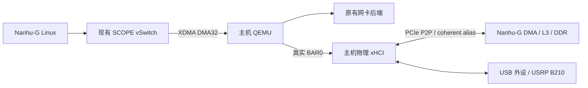

# Nanhu-G 沿用 SCOPE 接入主机外设

日期：2026-10-12。目录：`nexst_nanhu_g_host_peripherals`。
主仓库及 QEMU 的本地开发分支：`feature/nanhu-g-host-nic-usb`。

## 结论与范围

按用户确认，沿用现有 Nanhu-G / nm37 VU37P SCOPE 硬件，网卡直接使用此前的
后端与部署配置。**本次不需要新增 FPGA 逻辑，也不需要为新增 USB 后端重新综合
比特流**，前提是所用镜像已经包含当前 SCOPE 的 vSwitch、BAR_WRITE_DONE、
coherent alias 和 role DMA 通路。普通 Nanhu-G 镜像或缺少这些功能的旧镜像不满足前提。
这项结论不适用于换到 VP1902 的板级移植。

原 Nanhu-G 已经实现物理 xHCI 后端和 guest PCI DMA helper。此次复制整个本地
工作区的源码与 Git 历史到独立目录，保留原有未提交修改，补充 USB 与已有设备的
组合配置工具、可重建的 QEMU 补丁、独立的软件构建和带日志的启动入口。
生成的 Vivado 工程、历史构建目录等不复制；具体排除项和源提交见
[nanhu-host-proxy-import.json](nanhu-host-proxy-import.json)。原工作区不作修改。

**网卡没有调整。** `scope_fpga_vswitch.c`、`igb`、`ixgbe` 以及 xHCI 后端均与
原 Nanhu-G 工作区逐字节一致；不引入昆明湖的 TAP/host-net 后端。
已有本地网卡或 remote-rdma 网卡，继续按原配置和原接入流程使用。
USB 工具只在配置末尾追加 xHCI，保持已有设备的顺序、参数和虚拟 BDF。

## 为什么可以复用硬件

| 接口 | 原 Nanhu-G 的实现 | 本次动作 |
| --- | --- | --- |
| guest ECAM | `0x60000000` / 16 MiB，虚拟配置空间 | 沿用 |
| guest BAR MMIO | `0x50000000` / 256 MiB，由 proxy 转发 | 沿用 |
| host mailbox | XDMA user BAR 偏移 `0x1000000` | 沿用 |
| host ECAM shadow | XDMA user BAR 偏移 `0x1010000` / 128 KiB | 沿用 |
| 控制报文 | 原 32-byte XDMA DMA32 ring，含 BAR_WRITE_DONE | 沿用；不切换 BAR FIFO |
| DMA alias | bypass 偏移 `0x100000000 + guest PA`，桥减去 alias 基址后进入 role DMA | 沿用 |
| SoC DMA | `s_axi_dma → xs_top/dma_0 → AXI4ToTL → L3 xbar` | 沿用 |
| INTx | proxy mailbox 聚合中断，guest DTS 映射到 PLIC 2 | 沿用 |

接线证据位于 `shell/nm37_vu37p/fpga/scripts/xiangshan.tcl`、
`nanhu-g/fpga/wrapper/proto.tcl` 和
`nanhu-g/hardware/xs-gen/src/main/scala/system/SoC.scala`。
与昆明湖 CHI/OpenLLC 不同，Nanhu-G 已有接通的外部 DMA 入口；本次不移植昆明湖
的 VP1902 shell、QDMA BAR FIFO、中断 34 或设备树。



## 需要的软件调整

1. 复制保留已有网卡实现、硬件和 DTS，不修改网卡配置。
2. 保留 xHCI 物理身份及 BAR 转发、READY/BME/RUN 门控、doorbell DONE 和 INTx；
   guest 的 xHCI function 通过 PCI vendor capability 获得 P2P DMA 地址域。
   `scope-p2p-dma.h` 及其安装工具可与昆明湖共用，当前 Linux 为 Nanhu-G 的 5.16，
   不替换成昆明湖 Linux 6.6。
3. 在原内核配置上合并 `config/host-proxy/usb.config`，保留 `IGB/IXGBE` 等原选项；
   单独生成 Linux / OpenSBI 软件镜像。已有镜像若已含这些 USB/DMA 配置可直接使用。
4. 迁移 initramfs 的绝对路径到新目录，检查文件存在，再嵌入新的 Linux Image；
   防止复制后继续读取原工作区的 rootfs 或内核。
5. 在原后端列表末尾追加实际 xHCI BDF。主机侧完成该 USB 控制器的端口归属、
   identity/no-IOMMU、PCIe P2P 和 FPGA BAR 窗口检查，继续使用原 SCOPE XDMA 驱动。

物理 xHCI 接管整个 PCI function，包含它管理的全部 USB 端口。
USB 的设备 P2P 路由和持续 DMA 尚须实机验收，CPU 读写 FPGA BAR 成功不能替代。
现有网卡的软件与运行参数不因添加 USB 而改变。

## 编译与回归

GitHub 分支保留主仓库原有的子模块版本；初始化 Nanhu-G 子模块仍需访问这些
版本所在的内网仓库。Linux/xHCI/XDMA 的本地修改已另存补丁，避免仅推送主仓库
而遗漏依赖改动。QEMU 使用公开 `Nullray/qemu` 基线，恢复脚本核对基线与补丁状态。
生成的二进制和本地日志不上传 GitHub。

在新仓库根目录执行：

```bash
cd /home/yanjiarun/nexst_proxy_17/nexst_nanhu_g_host_peripherals

# 新 checkout 初始化依赖后，恢复 Linux USB 和 XDMA UART 兼容补丁。
bash tools/guest/bootstrap.sh

# 主机 QEMU，使用原有 NIC + xHCI 实现。
bash tools/host/build.sh

# USB、guest DMA helper、原 DTS 和配置保持性回归，不访问真实 PCI 设备。
bash tests/host-proxy/run.sh

# 查看软件构建步骤；不会修改文件或启动构建。
bash tools/build_nanhu_host_software.sh --dry-run

# 只检查 RISC-V 内核 PCI DMA 集成。
bash tools/build_nanhu_host_software.sh --kernel-check

# 编译 Linux Image、原 Nanhu-G DTS 和 OpenSBI payload。
bash tools/build_nanhu_host_software.sh
```

构建工具默认 `CROSS_COMPILE=riscv64-linux-gnu-`、`JOBS=8`，可用同名环境变量覆盖。
它们只编译软件，不执行 Vivado、不重新综合 FPGA、不加载驱动、不解绑设备、
不下载镜像。复制的 rootfs 文件已通过存在性检查；需要更新应用时先按原 rootfs
流程重建，构建脚本再生成带当前路径的独立 manifest。

产物与日志：

| 路径 | 内容 |
| --- | --- |
| `qemu-mount/build-nanhu-host/qemu-system-x86_64` | 主机代理 |
| `build/nanhu-host/linux/arch/riscv/boot/Image` | RISC-V Linux |
| `build/nanhu-host/XSTop_vpcie.dtb` | 原 Nanhu-G 设备树 |
| `build/nanhu-host/opensbi/platform/ict/firmware/fw_payload.bin` | 带新 Image 的固件 |
| `build/software-logs/` | QEMU / 固件构建日志 |
| `build/verification/host-proxy-tests.log` | 本次软件回归日志 |
| `build/host-proxy-logs/` | 用 `--run` 启动后的代理日志 |

QEMU 独立仓库仍位于 `qemu-mount/`；原 USB 功能相对 QEMU 基线的补丁已导出到
`tools/host/patches/qemu-host-proxy.patch`。`bootstrap.sh` 可识别补丁已存在，
避免重复应用，也不会改写已有网卡后端。
QEMU 实现已提交到公开仓库
[Nullray/qemu 的 feature/nanhu-g-host-nic-usb 分支](https://github.com/Nullray/qemu/tree/feature/nanhu-g-host-nic-usb)，
锁定提交 `ca732b08d6fa2805c0fc81d56d295690155e3003`。新 checkout 的恢复脚本直接
使用该提交，也兼容原 `6a30be82ace2bb045fc75ab1a8815e8f56dd9ba5` 基线加保存的补丁。
Linux 和 XDMA 的对应补丁位于 `tools/guest/patches/`；完整固件构建会先核对并
恢复 Linux USB 补丁。恢复不会切换依赖版本，遇到不同基线或冲突会明确退出。

## 组合已有配置与 USB

`BASE_BACKENDS` 应指向此前实际使用的后端配置；复制来的 `vswitch-backends*.json`
保持原样。不要为了增加 USB 换成另一套网卡或存储配置。

```bash
export BASE_BACKENDS=/absolute/path/to/previously-used-backends.json
export FPGA_BDF=<实际FPGA的domain:bus:device.function>
export XHCI_BDF=<USB控制器的domain:bus:device.function>

# 原有只读检查；不修改驱动或 PCI 配置。
python3 tools/scope_usb_preflight.py
lspci -Dnn -t
lsusb -t
```

选定专用 xHCI 并按原 USB 操作流程释放该 function 后，完成实际设备检查：

```bash
sudo python3 tools/scope_usb_preflight.py \
  --xhci-bdf "$XHCI_BDF" --fpga-bdf "$FPGA_BDF"

# 另存配置；保留原网卡和其他设备的全部参数与顺序。
python3 tools/host/add_usb_backend.py \
  --base-backends "$BASE_BACKENDS" --xhci-bdf "$XHCI_BDF" \
  --output build/nanhu-host/backends-with-usb.json

# 先生成命令；默认不启动，不接触硬件。
python3 tools/host/run_host_proxy.py \
  --fpga-bdf "$FPGA_BDF" --xdma-prefix /dev/xdma0 \
  --backends build/nanhu-host/backends-with-usb.json --xhci-p2p
```

`/dev/xdma0` 必须替换为该 FPGA 对应的实例；实际启动会核对 user/control/bypass
三个字符设备的 sysfs PCI 归属，拒绝误用另一块 FPGA。
preflight 要求单独验证不同 root port 或 ACS 重定向下的真实 P2P 路由；其
`--allow-cross-root` 只用于已经实测确认的部署。

先按原流程使 Nanhu-G 保持 reset，再启动代理，待其初始化完成后按原 bootrom/
payload 装载流程加载新软件、解除 reset：

```bash
sudo python3 tools/host/run_host_proxy.py \
  --fpga-bdf "$FPGA_BDF" --xdma-prefix /dev/xdma0 \
  --backends build/nanhu-host/backends-with-usb.json --xhci-p2p --run
```

启动时打印日志路径，随后 QEMU 输出自动写入该日志。
若原网卡部署启用了 `intx-retry-pulse=on`，启动脚本追加 `--intx-retry-pulse` 保留
原设置；默认保持关闭。不要让新旧代理同时操作同一 FPGA。
guest 使用原 `igb/ixgbe` 和标准 `xhci-pci` 驱动，以 `lspci -nnk`、`dmesg`、
`/sys/bus/usb/devices` 检查。USB 停机与主机重新接管沿用
[B650_USB_XHCI_OWNERSHIP.md](B650_USB_XHCI_OWNERSHIP.md)。

## 验证和后续验收

本次验证结果另见 [NANHU_G_HOST_PERIPHERALS_VALIDATION.md](NANHU_G_HOST_PERIPHERALS_VALIDATION.md)。
原先网卡的上板验证记录继续适用其原有实现；本次没有重新配置或测试物理网卡。
本次软件回归不能证明真实 xHCI 到 FPGA 的 P2P DMA 已工作。

B210 接入后还需在 Nanhu-G 用户态安装 libusb/UHD、相应 B2xx 固件与 FPGA image，
先验收固件下载后的重新枚举、双向 I/Q、硬件 timestamp 和持续传输。
手机 4G/5G 上网还需要 RAN、EPC/5GC 及与既有网卡的 IP 回程连接；这些没有包含在
本次 USB 接入工具中。B210 不直接把 USB 字节转换成手机 IP，完整链路仍要由
无线协议栈完成编码、调制、解调和协议处理。
