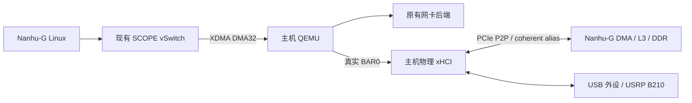

# Nanhu-G 沿用 SCOPE 接入主机外设

server48 的本地副本 `/home/yanjiarun/nexst_usb`、`/home/yanjiarun/qemu_usb`，以及按 maxiangyu history 核对的双终端启动命令，见 [USB 实验 Runbook](USB_EXPERIMENT_RUNBOOK_ZH.md)。

日期：2026-10-12。目录：`nexst_nanhu_g_host_peripherals`。
主仓库及 QEMU 的本地开发分支：`feature/nanhu-g-host-nic-usb`。

## 结论与范围

按用户确认，沿用现有 Nanhu-G / nm37 VU37P SCOPE 硬件，网卡直接使用此前的
后端与部署配置。**本次不需要新增 FPGA 逻辑，也不需要为新增 USB 后端重新综合
比特流**，前提是所用镜像已经包含当前 SCOPE 的 vSwitch、BAR_WRITE_DONE、
coherent alias 和 role DMA 通路。普通 Nanhu-G 镜像或缺少这些功能的旧镜像不满足前提。
这项结论不适用于换到 VP1902 的板级移植。

原 Nanhu-G 已经实现物理 xHCI 后端和 guest PCI DMA helper。此次复制整个本地
工作区的源码与 Git 历史到独立目录，保留原有未提交修改，补充 USB 与已有设备的
组合配置工具、可重建的 QEMU 补丁、独立的软件构建和带日志的启动入口。
生成的 Vivado 工程、历史构建目录等不复制；具体排除项和源提交见
[nanhu-host-proxy-import.json](nanhu-host-proxy-import.json)。原工作区不作修改。

**网卡没有调整。** `scope_fpga_vswitch.c`、`igb`、`ixgbe` 与原 Nanhu-G 工作区
逐字节一致。2026-10-13 上板排障后，物理 xHCI 后端增加了运行状态和无效
寄存器读数的中断保护；原始与修改后的哈希在导入记录中分别保存。
已有本地网卡或 remote-rdma 网卡，继续按原配置和原接入流程使用。
USB 工具只在配置末尾追加 xHCI，保持已有设备的顺序、参数和虚拟 BDF。

## 为什么可以复用硬件

| 接口 | 原 Nanhu-G 的实现 | 本次动作 |
| --- | --- | --- |
| guest ECAM | `0x60000000` / 16 MiB，虚拟配置空间 | 沿用 |
| guest BAR MMIO | `0x50000000` / 256 MiB，由 proxy 转发 | 沿用 |
| host mailbox | XDMA user BAR 偏移 `0x1000000` | 沿用 |
| host ECAM shadow | XDMA user BAR 偏移 `0x1010000` / 128 KiB | 沿用 |
| 控制报文 | 原 32-byte XDMA DMA32 ring，含 BAR_WRITE_DONE | 沿用；不切换 BAR FIFO |
| DMA alias | bypass 偏移 `0x100000000 + guest PA`，桥减去 alias 基址后进入 role DMA | 沿用 |
| SoC DMA | `s_axi_dma → xs_top/dma_0 → AXI4ToTL → L3 xbar` | 沿用 |
| INTx | proxy mailbox 聚合中断，guest DTS 映射到 PLIC 2 | 沿用 |

接线证据位于 `shell/nm37_vu37p/fpga/scripts/xiangshan.tcl`、
`nanhu-g/fpga/wrapper/proto.tcl` 和
`nanhu-g/hardware/xs-gen/src/main/scala/system/SoC.scala`。
与昆明湖 CHI/OpenLLC 不同，Nanhu-G 已有接通的外部 DMA 入口；本次不移植昆明湖
的 VP1902 shell、QDMA BAR FIFO、中断 34 或设备树。



## 需要的软件调整

1. 复制保留已有网卡实现、硬件和 DTS，不修改网卡配置。
2. 保留 xHCI 物理身份及 BAR 转发、READY/BME/RUN 门控、doorbell DONE 和 INTx；
   guest 的 xHCI function 通过 PCI vendor capability 获得 P2P DMA 地址域。
   `scope-p2p-dma.h` 及其安装工具可与昆明湖共用，当前 Linux 为 Nanhu-G 的 5.16，
   不替换成昆明湖 Linux 6.6。
3. 在原内核配置上合并 `config/host-proxy/usb.config`，保留 `IGB/IXGBE` 等原选项；
   单独生成 Linux / OpenSBI 软件镜像。已有镜像若已含这些 USB/DMA 配置可直接使用。
4. 迁移 initramfs 的绝对路径到新目录，检查文件存在，再嵌入新的 Linux Image；
   防止复制后继续读取原工作区的 rootfs 或内核。
5. 在原后端列表末尾追加实际 xHCI BDF。主机侧完成该 USB 控制器的端口归属、
   identity/no-IOMMU、PCIe P2P 和 FPGA BAR 窗口检查，继续使用原 SCOPE XDMA 驱动。

物理 xHCI 接管整个 PCI function，包含它管理的全部 USB 端口。
USB 的设备 P2P 路由和持续 DMA 尚须实机验收，CPU 读写 FPGA BAR 成功不能替代。
现有网卡的软件与运行参数不因添加 USB 而改变。

## 编译与回归

GitHub 分支保留主仓库原有的子模块版本；初始化 Nanhu-G 子模块仍需访问这些
版本所在的内网仓库。Linux/xHCI/XDMA 的本地修改已另存补丁，避免仅推送主仓库
而遗漏依赖改动。QEMU 使用公开 `Nullray/qemu` 基线，恢复脚本核对基线与补丁状态。
生成的二进制和本地日志不上传 GitHub。

在新仓库根目录执行：

```bash
cd /home/yanjiarun/nexst_proxy_17/nexst_nanhu_g_host_peripherals

# 新 checkout 初始化依赖后，恢复 Linux USB 和 XDMA UART 兼容补丁。
bash tools/guest/bootstrap.sh

# 主机 QEMU，使用原有 NIC + xHCI 实现。
bash tools/host/build.sh

# USB、guest DMA helper、原 DTS 和配置保持性回归，不访问真实 PCI 设备。
bash tests/host-proxy/run.sh

# 查看软件构建步骤；不会修改文件或启动构建。
bash tools/build_nanhu_host_software.sh --dry-run

# 只检查 RISC-V 内核 PCI DMA 集成。
bash tools/build_nanhu_host_software.sh --kernel-check

# 编译 Linux Image、原 Nanhu-G DTS 和 OpenSBI payload。
bash tools/build_nanhu_host_software.sh
```

构建工具默认 `CROSS_COMPILE=riscv64-linux-gnu-`、`JOBS=8`，可用同名环境变量覆盖。
它们只编译软件，不执行 Vivado、不重新综合 FPGA、不加载驱动、不解绑设备、
不下载镜像。复制的 rootfs 文件已通过存在性检查；需要更新应用时先按原 rootfs
流程重建，构建脚本再生成带当前路径的独立 manifest。
`/init` 与 `/etc/inittab` 使用主仓库 `tools/guest/include/nanhu-usb-*`
保存的输入，复现已验证的 devtmpfs/hvc0 和 BusyBox init shell；不会覆盖依赖目录中的文件。

产物与日志：

| 路径 | 内容 |
| --- | --- |
| `qemu-mount/build-nanhu-host/qemu-system-x86_64` | 主机代理 |
| `build/nanhu-host/linux/arch/riscv/boot/Image` | RISC-V Linux |
| `build/nanhu-host/XSTop_vpcie.dtb` | 原 Nanhu-G 设备树 |
| `build/nanhu-host/opensbi/platform/ict/firmware/fw_payload.bin` | 带新 Image 的固件 |
| `build/software-logs/` | QEMU / 固件构建日志 |
| `build/verification/host-proxy-tests.log` | 本次软件回归日志 |
| `build/host-proxy-logs/` | 用 `--run` 启动后的代理日志 |

QEMU 独立仓库仍位于 `qemu-mount/`；原 USB 功能相对 QEMU 基线的补丁已导出到
`tools/host/patches/qemu-host-proxy.patch`。`bootstrap.sh` 可识别补丁已存在，
避免重复应用，也不会改写已有网卡后端。
QEMU 实现已提交到公开仓库
[Nullray/qemu 的 feature/nanhu-g-host-nic-usb 分支](https://github.com/Nullray/qemu/tree/feature/nanhu-g-host-nic-usb)，
锁定提交 `bbc8bbb7c1c7a2963a7e274f0ba1ad0df2e7c916`。新 checkout 的恢复脚本直接
使用该提交，也兼容原 `6a30be82ace2bb045fc75ab1a8815e8f56dd9ba5` 基线加完整补丁。
此前发布的 `ca732b08d6fa2805c0fc81d56d295690155e3003` 使用
`tools/host/patches/qemu-xhci-usb-fixes.patch` 升级；已包含修复时只核验，不重复应用。
Linux 和 XDMA 的对应补丁位于 `tools/guest/patches/`；完整固件构建会先核对并
恢复 Linux USB 补丁。恢复不会切换依赖版本，遇到不同基线或冲突会明确退出。

如果依赖由旧服务器复制、缺少有效 Git 元数据，`tools/guest/bootstrap.sh` 会改为
逐文件核对保存补丁中的 Git blob 哈希。仅在所有涉及文件均匹配时恢复，并在
`build/dependency-restore/` 保存原文件；未知内容或部分应用状态会拒绝修改。
复制的 defconfig 若仅缺少原基线的 `CONFIG_IXGBE=y`，也会核对补回后的完整哈希，
恢复该选项。此方式验证补丁涉及的文件，不代表已确认整个依赖仓库的 commit。

## 组合已有配置与 USB

`BASE_BACKENDS` 应指向此前实际使用的后端配置；复制来的 `vswitch-backends*.json`
保持原样。不要为了增加 USB 换成另一套网卡或存储配置。

```bash
export BASE_BACKENDS=/absolute/path/to/previously-used-backends.json
export FPGA_BDF=<实际FPGA的domain:bus:device.function>
export XHCI_BDF=<USB控制器的domain:bus:device.function>

# 原有只读检查；不修改驱动或 PCI 配置。
python3 tools/scope_usb_preflight.py
lspci -Dnn -t
lsusb -t
```

选定专用 xHCI 并按原 USB 操作流程释放该 function 后，完成实际设备检查：

```bash
sudo python3 tools/scope_usb_preflight.py \
  --xhci-bdf "$XHCI_BDF" --fpga-bdf "$FPGA_BDF"

# 另存配置；保留原网卡和其他设备的全部参数与顺序。
python3 tools/host/add_usb_backend.py \
  --base-backends "$BASE_BACKENDS" --xhci-bdf "$XHCI_BDF" \
  --output build/nanhu-host/backends-with-usb.json

# 先生成命令；默认不启动，不接触硬件。
python3 tools/host/run_host_proxy.py \
  --fpga-bdf "$FPGA_BDF" --xdma-prefix /dev/xdma0 \
  --backends build/nanhu-host/backends-with-usb.json --xhci-p2p
```

`/dev/xdma0` 必须替换为该 FPGA 对应的实例；实际启动会核对 user/control/bypass
三个字符设备的 sysfs PCI 归属，拒绝误用另一块 FPGA。
preflight 要求单独验证不同 root port 或 ACS 重定向下的真实 P2P 路由；其
`--allow-cross-root` 只用于已经实测确认的部署。

### NM37 / B650 的启动前 P2P 实测

`tools/scope_usb_p2p_probe.py` 为当前 NM37 `10ee:903f` 与 B650 xHCI
`1022:43fd` 提供独立的 No-op DMA 检查。默认只打印计划，`--run` 会复位所选
香山、在 bootrom 安装 CPU 停驻循环，并暂时解绑 B650 xHCI。运行前拒绝选定
设备被进程打开、USB 存储被挂载/用作 swap、有 block holder 或接有 HID 的情况。
它不发出 USB 存储命令，不修改 U 盘文件，不能在需要保留当前 guest 运行状态时使用。

```bash
g++ -std=c++17 -O2 -Wall -Wextra -Werror tools/scope_usb_xhci_noop.cc \
  -o build/nanhu-host/xhci-p2p-noop
python3 tools/scope_usb_p2p_probe.py
sudo python3 tools/scope_usb_p2p_probe.py --run
```

默认选择 `0000:2a:00.0`、`0000:c2:00.0`、`/dev/xdma0` 和 scratch PA
`0x88000000`；可用同名命令行选项指定实际设备。执行时核对 PCI 身份与 XDMA
归属。GPIO reset 同时复位 SoC/L3，因此先释放 reset 并让 CPU 留在停驻循环，
再检查 coherent alias 的 CPU 读写；这个检查本身不证明 P2P。随后把命令环、
事件环、ERST、DCBAA 和实际能力要求的 scratchpad 放在 coherent DDR，物理
xHCI 执行 8 个 No-op 命令。只有 8 个完成事件的地址、类型和成功码均匹配，
才记录真实设备 DMA 读写通过。

完成后停止并复位 xHCI、关闭 BME，再使香山保持 reset，并重新绑定原主机 USB
驱动。U 盘重新枚举后块设备名可能变化。若 DMA 停止失败，保留控制器未绑定和
停驻程序，不复位它使用的内存；具体失败及恢复状态写入
`build/nanhu-host/p2p-probe-*.json`。该检查尚待本机实测；软件清理测试通过不代表
真实 P2P 已通过。No-op 检查也不能单独证明镜像里的缓存一致性接线；通过后仍需
正常启动代理/guest 验证一致性、BAR_WRITE_DONE、中断与 USB。

先按原流程使 Nanhu-G 保持 reset，再启动代理，待其初始化完成后按原 bootrom/
payload 装载流程加载新软件、解除 reset：

```bash
sudo python3 tools/host/run_host_proxy.py \
  --fpga-bdf "$FPGA_BDF" --xdma-prefix /dev/xdma0 \
  --backends build/nanhu-host/backends-with-usb.json --xhci-p2p --run
```

启动时打印日志路径，随后 QEMU 输出自动写入该日志。
若原网卡部署启用了 `intx-retry-pulse=on`，启动脚本追加 `--intx-retry-pulse` 保留
原设置；默认保持关闭。不要让新旧代理同时操作同一 FPGA。
guest 使用原 `igb/ixgbe` 和标准 `xhci-pci` 驱动，以 `lspci -nnk`、`dmesg`、
`/sys/bus/usb/devices` 检查。USB 停机与主机重新接管沿用
[B650_USB_XHCI_OWNERSHIP.md](B650_USB_XHCI_OWNERSHIP.md)。

### 正常启动卡在 xHCI 初始化时观察中断

`tools/guest/install_xhci_irq_diagnostics.py` 只给实际 Linux xHCI 驱动添加
串口输出，不生成额外 USB/DMA 请求，不修改中断确认和事件处理逻辑。
日志包含 USB3 控制器启动前后的位置，以及最多八次待处理中断、两次无待处理
状态的中断中，驱动 `xhc_state`、CPU 读到的四个事件 DWORD、消费者 cycle
和 dequeue DMA 地址。
退出日志位于事件处理之后；若只有进入日志，可据此缩小阻塞位置。

```bash
python3 tools/guest/install_xhci_irq_diagnostics.py work_farm/software/linux
bash tools/build_nanhu_host_software.sh
```

停止旧代理并确认物理 xHCI 已停止 DMA 后，按上述正常装载流程重新启动。
观察串口中的 `SCOPE-DIAG`，并与**本次启动**的 ERDP/ERST 和 coherent alias
读取结果对应；事件环地址会随镜像或启动变化，不能直接沿用上次的地址。
coherent alias 与 raw DDR 内容不同，单独不能证明 CPU 读到了陈旧数据。
诊断结束后移除日志并重编正常镜像：

```bash
python3 tools/guest/install_xhci_irq_diagnostics.py work_farm/software/linux --disable
bash tools/build_nanhu_host_software.sh
```

## 验证和后续验收

2026-10-13 的后续实验已确认 guest 枚举读卡器 `05e3:0751` 和 SD 卡，
`ro,noload` 挂载后可读取 `README.txt`、`etc/os-release`，README SHA-256 与主机记录一致。
DMA32 接收区的修复与证据见 [USB_BAR_DONE_FAILURE_ANALYSIS_ZH.md](USB_BAR_DONE_FAILURE_ANALYSIS_ZH.md)。
SD 卡带有 ext4 error/recover 标志，相关限制见
[USB_EXT4_READONLY_DIAGNOSIS_ZH.md](USB_EXT4_READONLY_DIAGNOSIS_ZH.md)。
以下为较早的启动问题及对应修复：guest 已枚举 `1022:43fd`、接受 DMA 窗口，
CPU 在中断中读到有效端口事件，但事件 dequeue 没有推进。
当前构建入口自动通过 `install_xhci_start_fix.py` 移植 Linux 上游提交
[`a808925075fb`](https://git.kernel.org/pub/scm/linux/kernel/git/torvalds/linux.git/commit/?id=a808925075fb750804a60ff0710614466c396db4)：
USB2 根集线器阶段保持中断关闭，启动控制器时在 `spin_lock_irqsave` 保护下
开启中断，并完成软件运行状态切换。保留 5.16 的 shared HCD 状态更新。

QEMU 对普通事件仅在物理 `RUN=1` 且 `HCHalted=0` 时转发 INTx，拒绝
USBCMD/USBSTS/IMAN 的全 1 读数，继续转发 HSE/HCE 硬件错误中断。
后端不替 guest 确认事件，不丢弃端口事件。此保护不能观察内核的 `xhc_state`，
因此仍需上述内核启动锁。测试新版本时必须重新启动 QEMU 并重新装载固件。

本次验证结果另见 [NANHU_G_HOST_PERIPHERALS_VALIDATION.md](NANHU_G_HOST_PERIPHERALS_VALIDATION.md)。
原先网卡的上板验证记录继续适用其原有实现；本次没有重新配置或测试物理网卡。
目前已验证读卡器枚举、容量与分区读取、只读文件内容及一个文件的主机/guest 哈希对照；
尚未验证 SD 写入、持续高负载或 B210。

B210 接入后还需在 Nanhu-G 用户态安装 libusb/UHD、相应 B2xx 固件与 FPGA image，
先验收固件下载后的重新枚举、双向 I/Q、硬件 timestamp 和持续传输。
手机 4G/5G 上网还需要 RAN、EPC/5GC 及与既有网卡的 IP 回程连接；这些没有包含在
本次 USB 接入工具中。B210 不直接把 USB 字节转换成手机 IP，完整链路仍要由
无线协议栈完成编码、调制、解调和协议处理。
