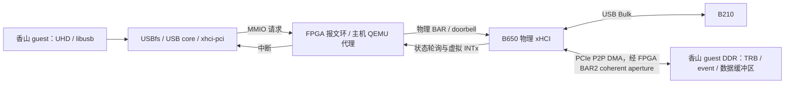

# Nanhu-G 经 B650 接入 NI USRP B210 的软件适配分析

核对日期：2026-10-14（北京时间）。分析对象为 `/home/yanjiarun/nexst_usb` 和
`/home/yanjiarun/qemu_usb` 的当前工作树，以及现有 guest 内核配置、initramfs。
本次只做代码和官方资料分析，未启动香山、未接入或实测 B210，也未构建 UHD。

后续软件准备已完成：本工作区交叉构建 UHD 4.11.0.0/libusb 1.0.30，生成
独立 `build/nanhu-b210` 固件并验证 RV64 CLI、运行库闭包及 initramfs 集成。
用户随后完成了 B210 probe 与接收测试；当前启动、测试命令和结果统一见
[运行 runbook](USB_QEMU_RESTART_FIXED_START_ZH.md#51-香山内的-b210-初始化和接收测试)。

## 结论

**B210 的基本接入原则上可以复用现有 SCOPE 物理 xHCI 后端，无需新增射频设备后端。**
当前代理对象是 B650 的整个 PCI xHCI function，而非指定读卡器。设备识别、
USB 请求组织和 B210 协议处理分别由 guest 的 USB 栈和 UHD 完成。
优先需要补齐 guest 的 RISC-V 用户态软件；持续采样能力则需独立验收。

USB 同样需要 DMA 地址转换，但由 guest 的 xHCI DMA API 统一处理。
与 NVMe/NIC 的主机侧地址改写对照见
[USB_DMA_ADDRESS_TRANSLATION_ZH.md](USB_DMA_ADDRESS_TRANSLATION_ZH.md)。

| 层次 | B210 接入所需工作 | 原因 |
| --- | --- | --- |
| SCOPE/QEMU xHCI 后端 | 基本接入先复用当前代码和 `type=xhci` 配置 | 后端代理控制器的 PCI 配置、BAR、doorbell 和中断，不按 USB VID:PID 或存储协议分流 |
| guest USB/xHCI 内核 | 先沿用现有配置和 P2P DMA 补丁 | 标准 USB 请求通过控制器的 DMA device 使用既有映射 |
| guest 用户态 | 增加 UHD、libusb、运行依赖及匹配版本的 B2xx images | B210 的设备控制和 I/Q 数据收发由 UHD 承担；现有 BusyBox rootfs 没有这些组件 |
| Nanhu-G FPGA/BAR2 | 基本 USB 接入先沿用现有 coherent aperture | BAR2 映射承载控制器对 guest 内存的 DMA，不区分 SD 数据和 I/Q 数据 |
| 高速持续采样 | 实测后按瓶颈决定是否改后端、guest 或应用 | 读卡器文件读取不能证明双通道持续收发的吞吐和时延 |

UHD 官方将 USB transport 定义为基于 libusb 的异步 **Bulk** 传输。
因此不能仅因为 B210 处理实时采样，就认定它需要 USB Isochronous 后端。
参见 [UHD USB transport](https://files.ettus.com/manual/page_transport.html)。

## 代码依据与数据路径



控制路径经过 QEMU，USB payload 则由物理 xHCI DMA 访问 FPGA 上的 guest DDR。
这里描述的是控制器 DMA 路径；USBfs 和 UHD 内部仍可能存在内存复制及格式转换，
不能据此宣称应用端端到端零复制。

关键代码位置：

- `qemu_usb/hw/misc/scope_fpga_vswitch_xhci_backend.c` 的
  `scope_xhci_process_bar_packet()`（约第 379 行）按寄存器地址、长度和 strobe
  转发 BAR 访问，按 doorbell 范围执行 DONE 握手；没有读卡器 VID:PID 或 SD/SCSI 分支。
- `nexst_usb/tools/guest/include/scope-p2p-dma.h` 的
  `scope_p2p_dma_configure()`（约第 41 行）为 PCI xHCI 控制器设置 `dma_range_map`，
  覆盖 guest RAM。映射关系为：`DMA bus address = FPGA BAR2 base + coherent alias base + guest physical address`。
- guest Linux `drivers/usb/core/hcd.c` 的 `usb_hcd_map_urb_for_dma()`
  使用 `hcd->self.sysdev` 映射 setup 和 transfer buffer；USBfs 的异步请求最终提交 URB。
  USBfs mmap 路径在 `drivers/usb/core/devio.c:217` 使用 `usb_alloc_coherent()`，
  也经控制器的 DMA 分配路径，而非读卡器专用映射。

故 B210 不需要新增一套射频 DMA 地址翻译。UHD 负责其协议，xHCI 负责执行 USB 事务。
这是从现有代码得出的可复用性判断，尚不是 B210 上板验证结果。

## 当前 guest 缺少什么

`build/nanhu-host/linux/.config` 已启用 `CONFIG_USB`、`CONFIG_USB_XHCI_HCD`、
`CONFIG_USB_XHCI_PCI`、`CONFIG_SCOPE_PCIE_P2P_DMA` 和 devtmpfs。
标准 B210 的 Linux UHD/libusb 路径不依赖 `CONFIG_USB_SERIAL` 或 `CONFIG_USB_ACM`。
其他串口射频板、USB 无线网卡等设备仍需各自的 guest 驱动，不能由 B210 的结论推及全部设备。

现有 `nanhu-g/software/rootfs/initramfs` 只有 BusyBox、启动脚本和 pciutils 等最小组件，
没有 UHD、libusb 或 B210 images。需准备：

1. 与 guest ABI 和 libc 匹配的 **RISC-V 64 位** libusb、UHD 及所选版本的运行依赖。
2. `uhd_find_devices`、`uhd_usrp_probe`、`benchmark_rate`；测试工具与 UHD 库版本保持一致。
3. 配套 B2xx 固件和 B210 FPGA image，部署到 UHD 可发现的 images 目录。
4. 可用的 `/dev/bus/usb` 和相应访问权限。当前 guest 使用 root shell，无需照搬主机的 udev 命令；
   若改成普通用户运行，再提供设备权限管理。

安装到 x86 主机的 UHD 不会自动成为 guest 可执行程序。需交叉构建或提供匹配的
RISC-V 软件包；本次尚未验证所选 UHD 版本在当前 Nanhu-G ABI 上的编译与运行。
依赖和构建选项参见 [UHD 构建文档](https://files.ettus.com/manual/page_build_guide.html)。

B210 初始化还包含固件下载、USB 重新枚举和 FPGA image 加载，必须分别验证。
UHD 的 `b200_find()` 实现了固件加载及等待重新枚举；B210 使用 B2xx 家族的
`type=b200` 选择器。这些 images 属于 **B210 自身**，与 Nanhu-G 的 FPGA bitstream 不同。
参见 [B2xx 手册](https://files.ettus.com/manual/page_usrp_b200.html) 和
[UHD B2xx 实现](https://github.com/EttusResearch/uhd/blob/master/host/lib/usrp/b200/b200_impl.cpp)。

## 什么时候可能需要修改软件后端

当前代码有以下值得在 B210 上检验的边界：

- xHCI 对 guest 只暴露一个 interrupter，使用虚拟 legacy INTx；物理事件状态由主机线程轮询。
- `scope_proxy_rx_thread()` 每次扫描最多 128 个 32-byte 位置；没有进展时 `g_usleep(20)`。
  20 微秒是睡眠请求值，并非端到端中断延迟保证。
- `ScopeXhciState` 只保存一个 pending doorbell。多 endpoint 并发请求是否始终满足现有
  握手顺序，需要负载验证；若下一笔 doorbell 在前一笔尚未完成时到达，当前路径没有排队支持。
- doorbell 等待 DONE 超过 1 秒时，后端进入失败状态并关闭物理 DMA。

相关实现见 `scope_fpga_vswitch_xhci_backend.c:416`、`:426`、`:463` 和
`scope_fpga_vswitch.c:6767`。这些限制说明需要测量，并不证明 B210 必然触发故障。
若出现 DONE 丢失、并发 doorbell 被拒绝、事件中断无法及时交付等后端问题，才针对
报文环、握手、排队或中断转发修改；若主要是 UHD 线程、格式转换或应用消费跟不上，
则应先处理 guest/应用及缓冲参数。单独增大超时不能解决持续吞吐不足。

例如使用 `sc16` 传输格式，每个复数样本为 I16 + Q16，共 4 字节。
双通道 RX、每通道 30.72 MS/s 对应 `30.72e6 × 2 × 4 = 245.76 MB/s`
采样 payload，尚未计入协议开销。该值是需求计算，不是当前系统已达到的带宽。
同速双通道 TX 会再增加一个方向的数据流和 guest 内存/CPU 负载。

当前读卡器日志是 USB high-speed（USB 2.0）；它不能证明 B210 的 SuperSpeed 路径已验证。
持续高采样率测试需确认 B210 的实际 USB 3 链路、线缆及供电符合设备要求；
UHD 日志会显示 `Operating over USB 3` 或实际使用的版本。

## 建议验收顺序

在 guest 软件已经备齐、B210 接入同一 B650 控制器后，先执行设备发现与 probe，
再做低速单通道 RX。以下是后续 guest 命令示例，本次未执行：

```sh
lsusb
ls -l /dev/bus/usb/*/*
uhd_find_devices --args="type=b200"
uhd_usrp_probe --args="type=b200"
benchmark_rate --args="type=b200" --rx_rate=1e6 --rx_channels=0 \
  --rx_otw=sc16 --rx_cpu=sc16 --duration=60
```

`benchmark_rate` 的安装位置依构建选项而定；若未放入 PATH，使用实际路径。
参数参见 [官方测试程序](https://github.com/EttusResearch/uhd/blob/master/host/examples/benchmark_rate.cpp)，
以所部署版本的 `--help` 为准。首次发现时应观察固件下载后的重新枚举，以及 probe 的 image 兼容性检查。

低速通过后逐步增加采样率、持续时间和通道数，再按实验需求测试 TX、双向收发及 timestamp。
记录实际采样率、overflow/underflow、丢样、sequence error、timeout、late command，
并对照 QEMU 的 doorbell/DONE/失败日志。`lsusb` 或一次 probe 成功不足以作为持续采样验收。
性能测试时也需评估逐次 MMIO/IRQ 调试日志的开销。
