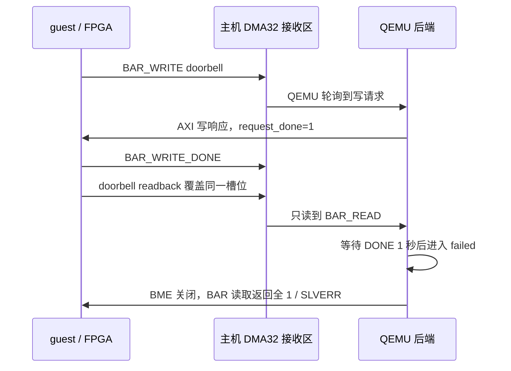

# USB 枚举卡住：DMA32 接收报文覆盖

2026-10-13。分析对象为 `/home/yanjiarun/nexst_usb`、`/home/yanjiarun/qemu_usb` 和本轮 NM37/B650 实验。

已经找到并修复主机 XDMA 接收区的单描述符覆盖缺陷：每条报文写回同一地址，`BAR_WRITE_DONE` 可被随后发出的 BAR 读取覆盖。软件测试复现了该故障。`20261013-123859` 实验已经加载修复模块，DONE 与物理 doorbell 提交正常，guest 成功枚举读卡器及 SD 卡分区，并完成目录、Ubuntu 18.04.6 `os-release` 和 README 文件读取。README 哈希与先前主机读取一致，文件读取目标已达成。另有 ext4 bitmap/descriptor 计数不一致待诊断，见 [只读文件系统检查](USB_EXT4_READONLY_DIAGNOSIS_ZH.md)；本轮结果不证明整张卡文件系统无错误。

## 现场证据

| 检查 | 结果 | 含义 |
|---|---|---|
| guest `lsusb` | `1d6b:0002`、`1d6b:0003` | Linux 的 USB2/USB3 root hub，尚未枚举读卡器 |
| 第一次 IRQ | 消费 type 34、port 10 事件，ERDP 从 `0x208182616000` 到 `...6010` | 初始端口中断和部分 event DMA 路径已工作 |
| 物理 `USBCMD=5`、`USBSTS=0` | RUN/INTE 开启，无 Halted/HSE/HCE | 物理控制器没有报告死亡 |
| 物理 `PORTSC10=0x2e1` | CCS=1 | 读卡器的连接仍存在；不代表已分配 slot 或识别 SD |
| 物理 PCI COMMAND | `0x402`，BME=0 | guest 写入 COMMAND=6 后，物理 DMA 又被关闭 |
| 事件环 | 只有已消费的端口事件，后续无 Command Completion | Enable Slot 提交/完成链路需要检查 |
| DMA32 接收区 | 64 KiB 中仅 slot 0 有有效包：type 3、seq 540、offset 4 | 保留了最后一次 HCSPARAMS1 读取，历史 DONE 不在快照中 |

原始记录：[控制器与 DDR 快照](../build/nanhu-host/usb-failure-20261013-112208-1719836.json)、[主机接收区快照](../build/nanhu-host/usb-failure-20261013-114003-1729380.json)、[本轮 UART](../build/usb-experiments/20261013-104827/guest-uart.log)、[本轮 QEMU](../build/usb-experiments/20261013-104827/qemu.log)。快照是故障后的非原子读取，不能替代运行期间的完整报文记录。

后续 `20261013-120931` 实验已经换用 `build-usb-local/qemu-system-x86_64`，但 `/sys/module/xdma/srcversion` 仍为旧模块 `E8D778DA2B4752B55C46541`，新模块产物为 `8813CBD0853FD1FC9DA7C8A`。主机内核日志仍显示旧的 `cyclic DMA started on C2H channel 1!`。该轮 [QEMU 详细日志](../build/usb-experiments/20261013-120931/qemu-debug.log) 记录：

```text
waiting for DONE backend=0 seq=527 off=0x1800 value=0x0
BAR read backend=0 seq=528 off=0x1800 size=4 resp=0 data=0x0 failed=0
...
BAR read backend=0 seq=534 off=0x38 size=4 resp=2 data=0xffffffffffffffff failed=1
BAR read backend=0 seq=535 off=0x3c size=4 resp=2 data=0xffffffffffffffff failed=1
BAR read backend=0 seq=536 off=0x4 size=4 resp=2 data=0xffffffffffffffff failed=1
```

stderr 确认等待 `527` 的 DONE 达到 1 秒后关闭 DMA。现在能够确认具体 pending 序号及后端失败原因；日志仍不能单独证明 FPGA 是否发出过被覆盖的 DONE。需要先加载新模块形成独立接收槽位，再进行下一轮验证。重新绑定 PCI function 使用的仍是已加载模块，不等同于替换模块。

## 为什么会覆盖 DONE

`cdev_ctrl.c` 原来按最大 4 MiB 分段配置循环描述符。本轮仅申请 64 KiB，因此只得到 **一个指向自身的描述符**，其目的地址始终是接收区起点。

FPGA 的 `virtual_pcie_switch_proxy.v::send_packet` 每次发送 32 字节有效载荷，设置 `tkeep=0xffffffff`、`tlast=1`。根据 [AMD PG195 v4.1，第 27 页](https://www.amd.com/content/dam/xilinx/support/documents/ip_documentation/xdma/v4_1/pg195-pcie-dma.pdf)，C2H 遇到包尾会结束当前描述符，然后处理下一描述符；它不会继续填当前描述符的剩余 64 KiB。于是每条包都写在 offset 0。

普通 CFG/BAR 请求需要等待软件回复，通常能被轮询线程读取。doorbell 则多了一条没有独立主机 ACK 的 DONE：



FPGA 在收到 guest 的 AXI B 响应握手后发 DONE，并允许后续 MMIO。Linux `xhci_ring_cmd_db()` 写 DB0 后马上读回 doorbell，故 DONE 和读请求可相邻到达。QEMU 分批扫描接收区，无法保证在两条包之间读到这个瞬时 DONE。扩大缓冲区大小、加长超时或扫描次数都不能恢复已经覆盖的包。

后端进入 `failed` 后阻止物理 DMA，也拒绝后续 guest BAR 访问。Linux 的命令超时处理读到 CRCR 全 1 时会报 `host controller not responding, assume dead`；设备 slot 分配失败分支读取 HCSPARAMS1 低 8 位，又把 `0xff` 打印为 255。物理 HCSPARAMS1 实际为 `0x1200087f`，MaxSlots 为 127。这条报错不能用来判断设备数量已满。

## 本次修复和验证

主机驱动将 64 KiB 接收区配置为 **1024 个 64 字节描述符**，各描述符目的地址相差 64 字节，最后一个链接到第一个。报文仍然是原来的 32 字节格式；满足 PG195 的 C2H 长度粒度，QEMU 现有的 32 字节扫描也可以读取所有报文。

每个槽位后半段保存 8 字节 C2H metadata，避免原代码把 metadata 写回地址设置为 0。metadata 魔数与报文不同，扫描器会跳过它。该环仍是有限容量循环区；过载时覆盖风险需要通过流量和持续测试评估，不能据此承诺任意负载无丢包。

源码：[描述符构造器](../shell/software/xdma_drv/XDMA/linux-kernel/xdma/nexst_dma32_ring.h)、[分配路径](../shell/software/xdma_drv/XDMA/linux-kernel/xdma/cdev_ctrl.c)。依赖目录不带 Git 元数据，因此修复还保存为 [可校验补丁](../tools/guest/patches/xdma-dma32-packet-ring.patch)，由 `tools/guest/bootstrap.sh` 在 UART 兼容补丁之后应用。

QEMU 新增默认可见的失败原因、pending seq、BAR offset 和等待时间；启用 `-d guest_errors` 时还记录等待 DONE、收到 DONE、物理 doorbell 提交及 BAR 请求。继续保留 DONE 握手和超时关闭 DMA 的行为。

测试使用生产 QEMU 与文件模拟 PCI/XDMA，没有访问物理设备：

- `single-slot`：让 DONE 和 readback 连续覆盖槽位 0，稳定复现 BME 关闭、CRCR/HCSPARAMS1 全 1 与 255 诊断。
- `packet-ring`：同样的连续报文分别放到独立 64 字节槽位，确认 DONE 保留、物理 doorbell 提交、BME 保持开启。
- C 描述符测试直接编译生产构造器与实际 libxdma 辅助函数，检查 4 KiB、64 KiB、4 MiB 的地址分离、循环链接、64 字节长度、metadata 边界，并使用 ASan/UBSan。
- 当前主机内核 `6.8.0-146-generic` 的模块编译通过。原 UART 源码仍有两处缺少原型的 warning；本次描述符代码没有编译错误。

记录：[旧二进制复现](../build/software-logs/usb-done-overwrite-reproducer.log)、[完整回归](../build/software-logs/usb-dma32-fixed-regression.log)、[驱动编译](../build/software-logs/usb-dma32-driver-build.log)、[QEMU 编译](../build/software-logs/usb-local-qemu-build.log)。

新产物为 `/home/yanjiarun/qemu_usb/build-usb-local/qemu-system-x86_64` 和 `build/usb-dma32-driver/linux-kernel/xdma/xdma.ko`。驱动构建脚本仅构建，不安装或加载：[build_usb_dma32_driver.sh](../tools/build_usb_dma32_driver.sh)。

## 下一轮验收

2026-10-13 后续物理实验 `20261013-123859` 已取得以下进展：

- 主机实际加载的模块 srcversion 为 `8813CBD0853FD1FC9DA7C8A`。
- 内核日志确认 `NexST proxy cyclic DMA started on C2H channel 1: 1024 slots, 64 bytes/slot!`。
- [本轮详细日志](../build/usb-experiments/20261013-123859/qemu-debug.log) 连续记录 `waiting for DONE`、`DONE`、`doorbell committed`。
- 用户提供的 guest UART 输出确认 `usb-storage 1-5:1.0`、读卡器 `05e3:0751` 和 `/dev/sda`：122138624 个 512 字节逻辑块（58.2 GiB），分区 `sda1`–`sda14`，并报告写保护。

这轮已经通过 USB 枚举、SCSI 容量及分区读取，文件内容验收按 [Runbook 第 6 步](USB_EXPERIMENT_RUNBOOK_ZH.md) 的只读 ext4 挂载、主机哈希对照和连续读取进行。下面的驱动切换仅用于开始新实验前版本不一致的情况，当前运行无需再切换模块。

按 [Runbook 的驱动切换步骤](USB_EXPERIMENT_RUNBOOK_ZH.md#dma32-接收环修复后的驱动切换) 完整停止旧实验，再切换模块和 QEMU。仅重启旧 QEMU、修改 alias 或重新编译 guest 内核，不能改变已经由旧主机驱动创建的单描述符接收区。

下一轮先确认主机日志出现 `1024 slots, 64 bytes/slot`，再确认 QEMU 的 `waiting for DONE`、`DONE`、`doorbell committed` 序号一致。随后检查 guest `lsusb` 出现 `05e3:0751`、`/proc/partitions` 出现 SD 容量，最终以 `ro,noload` 挂载并读取 `README.txt` / `etc/os-release`。达到最后一步才能确认 SD 文件目标完成。
