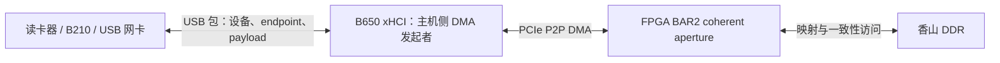

# USB、NVMe、NIC 的 DMA 地址转换与后端适配粒度

核对日期：2026-10-14（北京时间）。依据 `nexst_usb` / `qemu_usb` 当前工作树。
本文解释现有实现；未启动香山、未改动驱动或物理设备状态。

## USB 数据是否经过 DMA

**当前 B650/xHCI 路径使用 DMA；USB 外设并不直接发起访问香山 DDR 的 PCIe DMA。**
读卡器、B210、普通 USB 网卡通过 USB 包与主机控制器通信；B650 上的 xHCI
读取内存中的队列/描述符，执行 USB 传输，并把接收数据和完成事件 DMA 写入内存。
外设内部也可能有自己的 DMA，但那是访问外设自身内存，与这里的主机内存 DMA 是两回事。



USB endpoint 地址用于选择设备中的通信端点，并不是 DDR 地址。普通 USB 事务中，
主机内存缓冲区地址由 host controller 的描述符指定，外设不需要知道它。
Linux 官方也明确区分 USB 外设与承担 DMA 的 USB 控制器，见
[USB host API：usb_intf_get_dma_device](https://docs.kernel.org/5.16/driver-api/usb/usb.html#c.usb_intf_get_dma_device)。

## 当前 USB 地址转换在什么地方

转换已经实现，并非因使用 USB 就不需要转换。当前实现顺序是：

1. QEMU 在虚拟 xHCI 的 PCI vendor capability 中提供 guest CPU 地址域和物理 PCIe DMA 地址域。
2. guest PCI 初始化调用 `scope_p2p_dma_configure()`，在 xHCI 的 `struct device` 上安装
   `dma_range_map`；该 helper 当前明确限定 PCI xHCI class。
3. USB core 使用控制器的 `hcd->self.sysdev` 调用 DMA API，将 URB 缓冲区映射为 DMA 地址。
4. guest xHCI 驱动把 DMA API 返回的地址写入 TRB、context 和 ring 等结构。
5. QEMU 转发控制寄存器及 doorbell，物理 xHCI 从 FPGA DDR 中读取这些已含正确 DMA 地址的结构，
   经 PCIe P2P 访问对应缓冲区。

ring、context 等一致性内存使用 `dma_alloc_coherent()` / DMA pool，同样通过控制器的
DMA device 获得映射后的 bus address。普通 URB 的 `dma_map_single()`、SG 映射和
`usb_alloc_coherent()` 路径都共用该控制器的地址域；并非只处理 SD 数据缓冲区。

当前配置的关系为：

```text
P = guest CPU 物理地址
A = coherent alias base
B = FPGA BAR2 在主机 PCIe 地址空间中的 base

xHCI 使用的 DMA bus address = B + A + P
```

沿用此前实验的 BAR2 base `0x208000000000`、alias base `0x100000000`，
以 `P = 0x8261600c` 为例：

```text
guest CPU 物理地址：          0x000000008261600c
FPGA BAR2 内 coherent 偏移：  0x000000018261600c
物理 xHCI 使用的 DMA 地址：   0x000020818261600c
```

这三个值属于不同地址空间。数值仅说明此前配置下的转换关系，不代表这个位置现在仍是
有效的某个 ring。BAR2 base 必须以实际配置为准。

代码依据：

- `qemu_usb/hw/misc/scope_fpga_vswitch_xhci_backend.c:35`：发布 DMA 地址域。
- `nexst_usb/tools/guest/include/scope-p2p-dma.h:41`：验证 xHCI class、安装 `dma_range_map`。
- guest Linux `drivers/pci/pci-driver.c:1610`：PCI DMA 初始化接入该 helper。
- guest Linux `include/linux/dma-direct.h:27`：按 `dma_range_map` 转换 CPU physical address。
- guest Linux `drivers/usb/core/hcd.c:1399`：URB DMA 映射使用 `hcd->self.sysdev`。
- guest Linux `drivers/usb/host/xhci-ring.c:3744`：Bulk TRB 使用 `urb->transfer_dma`。
- guest Linux `drivers/usb/host/xhci-mem.c:1817`：event ring segment table 的 DMA 分配与地址填写。

CPU 指针、CPU 物理地址和设备可使用的 DMA 地址必须区分，见
[Linux DMA mapping guide](https://docs.kernel.org/5.16/core-api/dma-api-howto.html)。

## 为什么 NVMe 和 NIC 的后端需要各自的逻辑

以当前物理 NVMe 与 igb/82580 后端为例，其主机侧代理会解析含地址的数据结构，
在物理设备消费前改写地址。结构格式、提交方式和需要改写的位置不同，所以适配代码不同。

| 接入对象 | 主机内存 DMA 发起者 | 地址所在的主要结构 | 当前转换位置 |
| --- | --- | --- | --- |
| PCIe NVMe | NVMe 控制器 | ASQ/ACQ、SQ/CQ、PRP1/PRP2/PRP list 等 | QEMU NVMe 队列及命令处理逻辑 |
| PCIe igb/82580 NIC | 网卡控制器 | TX/RX ring base、packet/header buffer descriptor 等 | QEMU igb 后端 |
| B650 下的普通 USB 外设 | B650 xHCI 控制器 | xHCI ring、context、TRB data buffer 等 | guest 的 xHCI DMA API 地址域 |

例如 NVMe 的 `scope_patch_simple_command_prps()` 与 `scope_patch_admin_cmd()`
分别改写 PRP 和创建队列命令；NIC 的 `scope_igb_sync_ring()` 与
`scope_igb_patch_tx_range()` 分别处理 ring base 和 TX buffer address。
它们位于 `scope_fpga_vswitch.c:3719`、`:4286` 和
`scope_fpga_vswitch_igb_backend.c:120`、`:217`。

**解析逻辑不同，不等于底层地址空间转换公式必须不同。** 当前 NVMe 和 igb
甚至共用 `scope_translate_guest_pa_for_real_dma()`；它的核心也是把 guest PA
转换为 FPGA BAR2 的 coherent PCIe 地址，见 `scope_fpga_vswitch.c:2891`。

因此应把适配粒度理解为 DMA 控制器及其编程接口。NVMe 后端可服务符合其支持范围的
NVMe 控制器；NIC 往往按控制器家族适配。USB 已经适配了 xHCI，因此同一控制器下
的不同普通 USB 外设可以复用它。

NVMe/NIC 驱动也使用 Linux DMA API；当前差别是 SCOPE 的这套 `dma_range_map`
helper 只为 xHCI 启用，而现有 NVMe/igb 采用主机侧地址改写。即使 USB 改成
主机侧解析并重写 TRB/context，也应按 xHCI 格式适配，仍不需要分别解析读卡器和 B210 的协议。

NVMe/NIC 原则上也可以研究把转换前移到 guest DMA API，但这属于实现迁移：
需要统一 guest 和后端的地址约定，调整现有地址改写与范围验证，覆盖完整 DMA 路径，
保留设备 MMIO、队列和中断语义。不能直接把当前 xHCI helper 打开给所有 PCI 设备，
否则既有后端可能拒绝已转换的地址或再次转换。

## 为什么换 USB 外设通常不必新增 SCOPE 后端

不同 USB 外设的数据格式，由 guest 的设备驱动或用户态库处理。例如读卡器使用
usb-storage/UAS 和 SCSI；B210 使用 UHD/libusb。它们最终都向 USB core 提交 USB 请求，
由同一个 xHCI 驱动转换为标准 xHCI 结构，并使用同一个控制器的 DMA 地址域。
这些协议 payload 中的 LBA、I/Q 样本、网络包等不因含有数字字段，就成为需要代理
改写的主机 DMA 指针。

所以，换读卡器为 B210、USB 网卡等普通 USB 外设，通常只需增加 guest 对该设备的
驱动、库或固件。若测试暴露 xHCI 后端的传输类型、并发、恢复或吞吐支持不足，仍需
修正通用控制器后端；若设备驱动绕过标准 DMA API，则需修正其 DMA 使用方式。
这与为每种外设编写一套 SCOPE 地址转换协议不同。

B210 的具体用户态要求和持续采样验收见
[USB_B210_BACKEND_ANALYSIS_ZH.md](USB_B210_BACKEND_ANALYSIS_ZH.md)。
