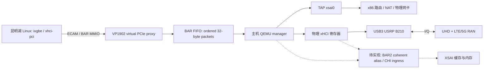

> 历史记录：当前普通单/双核 bridge 实现见 [KUNMINGHU_SCOPE_BRIDGE_IMPLEMENTATION.md](KUNMINGHU_SCOPE_BRIDGE_IMPLEMENTATION.md)。下文不是当前构建状态。

# VP1902 / 昆明湖 XSAI 主机网卡与 B210 接入开发记录

本地开发分支：`feature/vp1902-host-nic-usb`。基于 NexST `kunminghu-xsai`
提交 `de368defa2067adec12fb3c6ff24635115e19f70`。

## 当前实现边界

已实现并验证主机软件与代理控制面。**还不能用此版本让真实手机经 B210 上网。**
XSAI 的一致性 DMA 入口、BAR2 alias 分流与板级数据通路仍未实现，UHD/RAN/核心网
也尚未在 RISC-V 上部署。FPGA 队列的 `COHERENT_DMA` 默认保持 0；QEMU 启动会检查
它，并在缺少一致性能力时退出，避免将普通 DDR BAR 当作一致性 DMA 使用。

| 工作 | 当前状态 |
| --- | --- |
| 独立克隆 NexST、XSAI、XSAICache，保留 AI 配置 | 已完成主仓库及全部递归子模块初始化；130 个子模块均匹配当前 gitlink |
| 主机网卡共享 | 已增加 `host-net` / TAP 后端；复用 82599 寄存器/单队列模型与 guest ixgbe |
| QDMA AXI-MM 控制传输 | 已增加 BAR FIFO RTL 和 QEMU 接收；不依赖 XDMA DMA32 ioctl |
| 物理 xHCI 后端 | 已迁入原实现，保留 DMA READY/BME/RUN 和 doorbell DONE 门控 |
| Guest PCI DMA helper | 已安装至 Linux 6.6，RISC-V `pci-driver.o` 交叉编译通过；逐 PCI function 设置地址映射 |
| DT / OpenSBI | 已增加 2 GiB、generic ECAM、proto UART 的独立 DT；payload 使用实际生成 Image |
| VP1902 shell 控制面 | `pdas` / `uvhs2` 可通过 `SCOPE_HOST_PROXY=1` 接入；两者均已通过 Vivado 2025.1 BD 检查与工程生成 |
| CHI/OpenLLC 一致性 DMA、BAR2 alias | 待实现和仿真；role 的 DMA 仍是未连接状态 |
| B210 真实 USB3 枚举、双向 I/Q、吞吐与定时发送 | 待硬件验证 |
| 手机 LTE/5G 接入及 Internet 回程 | 待 UHD、基站协议栈、核心网部署与实时性验证 |

## 依赖版本

- XSAI：`280ea04ba4b79713e637491233283a804cf2d4c7`。
- XSAICache：`50bf1272c60116a62ad0e370bc1a2629e98a7d8a`。
- QEMU：新增子模块 `tools/host/qemu`，基线
  `6a30be82ace2bb045fc75ab1a8815e8f56dd9ba5`，公开分支 `Nullray/qemu:nm37_vswitch`。
  当前功能补丁保存于 `tools/host/patches/qemu-host-proxy.patch`；bootstrap 可重复应用。
- 上游锁定的 work_farm `a8353e7e7c842a54d71f504018c0da581634df36`
  在公开远端及当前内部远端均返回 `not our ref`。本分支明确采用公开 VP1902 版本
  `42d3d45e76d8331d5a89ace8355f7abdfb348fe5`。其 Linux gitlink 为
  `4e463b37b24e324cfdf40d6caaf6e6571a3214a5`。这不是对丢失版本的等价性证明；
  XSAI 启动和矩阵功能仍须在替代依赖上验证。

USB 和 proxy 的导入文件来源、原始哈希见 [host-proxy-import.json](host-proxy-import.json)。
旧 `nexst_proxy_16` 工作区的实现文件没有被修改。

## 通路与控制 ABI



TAP 将完整以太网帧交给主机网络栈，不接管主机物理网卡 PCI function。
Guest 看到 `8086:10fb` 单队列接口；它仍使用当前 82599 模型的功能范围。
首阶段关闭 TSO/GSO/GRO，并从单队列、1500 MTU 开始测试。

QDMA BAR1 固定为 16 MiB，以下全部为 BAR 内偏移：

| 偏移 | 范围 | 用途 |
| --- | --- | --- |
| `0x000000` | 2 MiB | 原 role control / bootrom / host UART / reset |
| `0x200000` | 4 KiB | proxy mailbox / BAR route / INTx |
| `0x220000` | 128 KiB | compact ECAM shadow BRAM |
| `0x240000` | 4 KiB | 有序请求 FIFO |

UVHS2 的 AXI 控制地址以 `0x10000000` 为基址，PDAS 使用 NoC remap；
主机软件统一使用上述 BAR 内偏移。数据访问独立走 BAR2；当前 BAR2 仍是 raw DDR 路径。

FIFO 寄存器：`0x00` magic `0x53465131`，`0x04` 深度，`0x08` 占用数，
`0x0c` head ticket，`0x10` POP（必须写完整、匹配的 ticket），`0x14` features
（bit 0 为 coherent DMA），`0x20..0x3c` head 的八个 DWORD。
PEEK 不消费请求；队列满时对 proxy AXIS 回压；重复或错误 POP 返回 SLVERR。
CFG ACK、BAR response commit-toggle、BAR_WRITE_DONE 的 packet ABI 保持原样。
主机只有一个消费者；运行前应先保持 guest CPU reset。

## 构建、回归与接入

以下操作在新仓库根目录执行。

完整硬件构建脚本为 `tools/build_vp1902.sh`，默认使用 UVHS2、单核
`MinimalMatrixConfig`、OpenLLC、Vivado 2025.1，并自动启用 vSwitch：

```bash
bash tools/build_vp1902.sh --dry-run
bash tools/build_vp1902.sh

# 分阶段执行；阶段模式不会追踪源码变化，切换配置后请执行完整流程。
bash tools/build_vp1902.sh --stage rtl
bash tools/build_vp1902.sh --stage shell
bash tools/build_vp1902.sh --stage role
bash tools/build_vp1902.sh --stage pdi

# 保留已经完成的 RTL/shell/role 工程，从综合开始续编到 PDI。
bash tools/build_vp1902.sh --from-step role-synth

# 只重新生成 role 工程，适用于修改 wrapper/BD 接线后。
bash tools/build_vp1902.sh --stage role-gen

# Vivado 安装位置不同则覆盖；脚本使用 work_farm 的 2025.1 目录约定。
VIVADO_TOOL_BASE=/opt/Xilinx_2025.1 bash tools/build_vp1902.sh
```

脚本串行执行六个步骤，检查命令状态、日志中的错误，以及新生成的非空产物。
默认 `VIVADO_MAX_THREADS=8`、`VIVADO_SYNTH_THREADS=1`，分别控制常规线程与
综合并行进程。`vivado_limits.tcl` 在上游固定的线程设置之后应用实际限额。
脚本通过 GNU make 的 `SHELL=/bin/bash` 和 `.SHELLFLAGS=-o pipefail -c` 将
Vivado 退出状态传过内部 `tee`；同时识别 `Killed`、segfault 和父进程死亡。
每次运行保存 `build-settings.txt`；失败原因写入同目录 `failure.log`。
RTL 阶段会重新生成，旧的 RTL 输出保存到该次日志目录的 `previous-rtl/`。
日志位于 `build/hardware-logs/<时间_PID>/`；完整流程成功后预期镜像为
`work_farm/hw_plat/target_kmh_proto_uvhs2/system.pdi`，调试探针为同目录下的
`debug_nets.ltx`。VP1902 使用 PDI；上游 README 中通用的 `system.bit` 路径不适用。
脚本已通过 Bash 语法、ShellCheck 及 11 项模拟回归（包括综合续编、崩溃检测、
递归 make 的 pipefail、线程配置、错误码被掩盖、旧产物和
时序失败），回归可用 `python3 tests/hardware/test-build-script.py` 执行。
脚本仅编译硬件，不构建 Linux/QEMU，也不下载到 FPGA。真实端到端构建尚未验证；
已有验证包括下文记录的 shell/role 工程生成、UVHS2 shell 综合和软件测试。一致性 DMA 仍未实现，
生成 PDI 不能视作网卡/USB 数据通路已经可用。

```bash
bash tools/host/bootstrap.sh
bash tools/host/build.sh
bash tests/host-proxy/run.sh

# 依赖初始化完成后，逐项安装 guest PCI DMA 补丁。
python3 tools/guest/install_pci_dma.py work_farm/software/linux
# 用 kernel 的 scripts/kconfig/merge_config.sh 合并 config/host-proxy/linux.config，
# 再执行 olddefconfig；核对 CONFIG_SCOPE_PCIE_P2P_DMA、IXGBE、USB_XHCI_PCI 实际生效。

cd work_farm
make PRJ=target:kmh:proto FPGA_BD=uvhs2 ARCH=riscv \
  DT_TARGET=xiangshan-host-proxy target_dt
SCOPE_HOST_PROXY=1 make PRJ=shell:uvhs2 FPGA_BD=uvhs2 \
  VIVADO_VERSION=2025.1 FPGA_ACT=prj_gen vivado_prj
# 同一 VP1902 器件下也验证了 PRJ=shell:pdas，FPGA_BD 仍为 uvhs2。
```

当前 `xiangshan-host-proxy.dts` 仅用于单核 bring-up。PLIC 34 来自 shell bit 1
映射到 proto `ext_intrs[33]`；UART 为 `0x40600000`、PLIC 4。必须用实际生成的
SoC DT 和 `/proc/interrupts` 核对，随后才能视为上板中断验收。
2 GiB RAM 是首阶段的软件配置；PDAS 的 DDR NoC remap 与 CPU PA 还须逐项验证。

`config/host-proxy/backends.example.json` 中 xHCI BDF 是示例，应换成专用控制器。
控制器的所有端口归 guest 使用；B210 所在的主机控制器需完成真实 P2P 检查。
TAP `xsai0` 的接口地址、路由/NAT 和主机出口应按部署环境配置。

```bash
# 默认只输出命令。--run 才运行；目前未完成 coherent ingress 的 shell 会被拒绝。
python3 tools/host/run_host_proxy.py --board uvhs2 \
  --fpga-bdf 0000:01:00.0 --backends config/host-proxy/backends.example.json \
  --xhci-p2p
```

回归覆盖 FIFO 顺序/满队列/回压/独立 AW-W/复位/错误 POP，生产 QEMU 的 TAP TX/RX
与描述符完成写回、INTx、无一致性拒绝、ABI/配置拒绝；xHCI 的 DMA32 和 BAR FIFO
两种传输分别覆盖 READY/BME/RUN、64-bit 和拆分访问、doorbell DONE、超时停机与
BIOS/MSI/IOMMU/绑定状态拒绝；BAR FIFO 还覆盖损坏请求及 POP 未提交时关闭物理
xHCI Bus Master Enable；guest helper 使用 ASan/UBSan 检查地址正反转换和恢复。
这些是仿真与文件 I/O 测试，不能计作真实 P2P 或手机接入验证。

本轮检查结果：QEMU `x86_64-softmmu` 构建通过（启用 RDMA，warnings-as-errors）；
上述回归共 34 项通过；实际 Linux 6.6 的 `drivers/pci/pci-driver.o` 在启用
`CONFIG_SCOPE_PCIE_P2P_DMA=y` 后交叉编译通过；UVHS2 / PDAS 控制面均完成
`validate_bd_design` 和 `generate_target`，ECAM BRAM 为 128 KiB。尚未执行完整 Linux
Image/rootfs、XSAI RTL 生成、FPGA 综合/实现或下载，也未连接真实 TAP/xHCI/B210 运行。
DT 编译仍有上游 `bus-error-unit` 缺少 `reg/ranges` 的非致命警告。
PDAS 工程还保留上游 QDMA support 的端口宽度警告；BD 校验与工程生成通过不能替代
PCIe 链路、综合时序与上板验收。
本工作区的构建与测试日志保存在 `build/verification/`（生成产物，不纳入源码补丁）。

## 2026-10-12 编译异常排查

用户发起的最新构建目录为 `build/hardware-logs/20261011_210523_389194`。
RTL 生成、shell 工程生成、shell 综合（363 MiB `synth.dcp`）及 role 工程生成完成。
`role-synth.log` 记录 2026-10-12 01:12 左右主进程 PID 401020 被 `Killed`，随后
`parallel_synth_helper` 因父进程死亡崩溃；用户确认最新这次没有手动停止，前两次
手动停止对应旧目录。未生成 role 综合 checkpoint，PDI 步骤尚未开始。

日志显示综合最多启动 7 个并行进程，主进程已报告 102707.812 MiB 的内存峰值，
该时刻主机可用物理内存约 24 GiB。内存峰值是主要嫌疑，但当前账号无法读取系统
内核/oomd 日志，尚不能把 OOM 认定为确诊；可见的当前会话 cgroup 没有 OOM 计数。
AMD 文档也说明并行作业可能耗尽内存导致崩溃：
[Vivado 2025.1 Logic Synthesis](https://docs.amd.com/r/2025.1-English/ug892-vivado-design-flows-overview/Logic-Synthesis)。

已加入上述单进程综合配置、细粒度阶段/续编、崩溃识别和真实退出码传递。
同时修复 role 的三个只读参数设置告警，并将 GPIO 的 32 位 boot 地址显式补零到
XSAI 的 48 位 `rst_vec`，消除高 16 位悬空。
修正后的 role 工程在 `20261012_170424_17858` 中生成成功，没有原来的关键 BD 告警；
检查生成 BD 确认 `{16'b0, boot_address[31:0]}` 的实际接线。
已从 `role-synth` 启动单进程续编，新日志目录为 `20261012_170726_19141`。
用户要求不持续监控编译；启动命令、后台执行方式和日志位置另见
[VP1902_BUILD_RUN.md](VP1902_BUILD_RUN.md)。
在生成新的 role checkpoint 和最终 PDI 之前，不能视为完整编译已经修复并验收。

## 2026-10-13 最新构建检查

最新目录为 `build/hardware-logs/20261012_203010_23470`。其 `build-settings.txt`
显示执行完整六阶段流程，RTL 日志在 20:30:11 报 `-avp: command not found`（Error 127），
没有启动 Mill/Vivado。这是 Bash 的 `time` 关键字与 XSAI Makefile 的 GNU time
参数冲突；此前为了将内部 `tee` 的失败传出而切换 Bash，触发了此问题。

已在主仓库的 `kmh/scripts/hardware.mk` 显式传入绝对路径 GNU time 命令，不改动
XSAI 子模块源码。构建脚本增加 GNU time 的预检查，11 项回归通过，RTL 测试现在
覆盖真实递归 make + Bash + GNU time。没有重新启动实际 RTL 或 FPGA 构建。

旧 RTL 保存在该轮 `previous-rtl/` 下，当前生成目录缺失。shell DCP 保留，role DCP、
post-route 时序报告、PDI 尚未生成。17:07 的旧续编日志截断在优化阶段，未提供
终止原因；不能把这次已明确的 RTL 命令错误归因于之前的内存问题。
当前无可见 Vivado 构建进程；启动前提和最新日志位置已更新至
[VP1902_BUILD_RUN.md](VP1902_BUILD_RUN.md)。

## 必须继续实现的内容

1. 给 OpenLLC 增加经过验证的外部 coherent requester；处理 partial writes、dirty
   CPU cache line、目录、node ID、snoop 和并发顺序。旧 `HaveSlaveAXI4Port` 与
   outbound OpenNCB 不能直接满足当前 CHI 架构。当前 L2 `SinkA` 也拒绝普通
   PutPartialData，并要求 Matrix Put 为完整 cache line，不能把 AXI4ToTL 直接接上。
2. 导出 XSAI DMA port，贯通 `xstop_wrapper`、`proto.tcl`、`role_top_proto`。
   在 VP1902 BAR2 增加 alias 分流与必要的 AXI 宽度/时钟转换，验证 NoC PA 映射。
   通过 CPU dirty read、DMA write、部分写、跨行和并发测试后才能设置 feature bit。
3. 上板验证网卡收发和 xHCI DMA；先 B210 固件下载、USB 重新枚举，再 UHD 持续双向
   I/Q、硬件 timestamp、timed TX、overflow/underflow/late packet 与恢复测试。
4. 移植 UHD/libusb；接入 LTE/5G RAN 与 EPC/5GC、测试 SIM 订阅信息。
   首阶段核心网可在 x86，XSAI 负责既定的无线处理；手机 IP 由 UPF/PGW 路由到外网。
   先低带宽、单手机、SISO，再根据实测时限增加 AI/FPGA 加速、带宽和 MIMO。

B210 是 I/Q 收发器，USB 使用 libusb asynchronous bulk transport。它不自动提供
基站/核心网；网络响应要经 RAN 编码调制为 I/Q，才能经 USB 发送回 B210。
相关公开资料：[B2x0 UHD 手册](https://files.ettus.com/manual/page_usrp_b200.html)、
[UHD USB transport](https://files.ettus.com/manual/page_transport.html)、
[srsRAN 手机接入教程](https://docs.srsran.com/projects/project/en/latest/tutorials/source/cotsUE/source/index.html)、
[Open5GS 快速开始](https://open5gs.org/open5gs/docs/guide/01-quickstart/)。
